<div align="center">


# Kaiku

**A friend on your desk, a voice in your ear, a clearer record for your care team.**

Kaiku (Finnish for "echo") helps people stay well at home after TMS treatment for depression.

**[Open the live demo](https://harrish21raj--kaiku-web.us-east.modal.run/?id=aino)** (a simulated record) ·
**[Pitch deck (PDF)](demo/deck/kaiku-deck.pdf)** · [Try it](#try-it) · [Is it any good?](#is-it-any-good)

<sub>Junction 2026 · Aalto University "Beyond the Clinic" · research prototype: not a medical device, not a crisis service · every record shown is simulated</sub>

</div>

<!-- VIDEO: add the public video link (maximum 2:00) next to the deck link once it exists. -->

<table align="center">
<tr>
<td align="center" valign="middle">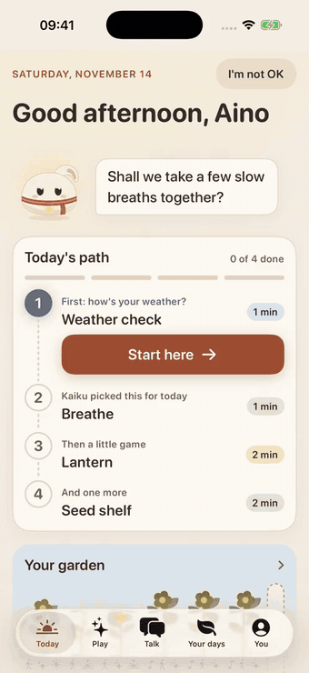<br><sub><b>iPhone</b><br>Today's path: Kaiku's invitation, the check-in as a small chat (typed lines, real Gemini Live replies), the Lantern game, the sky she lit</sub></td>
<td align="center" valign="middle">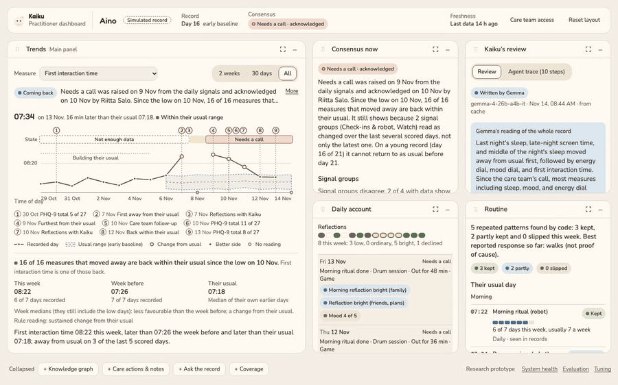<br><sub><b>Web</b><br>The practitioner dashboard on the public simulated record</sub></td>
<td align="center" valign="middle">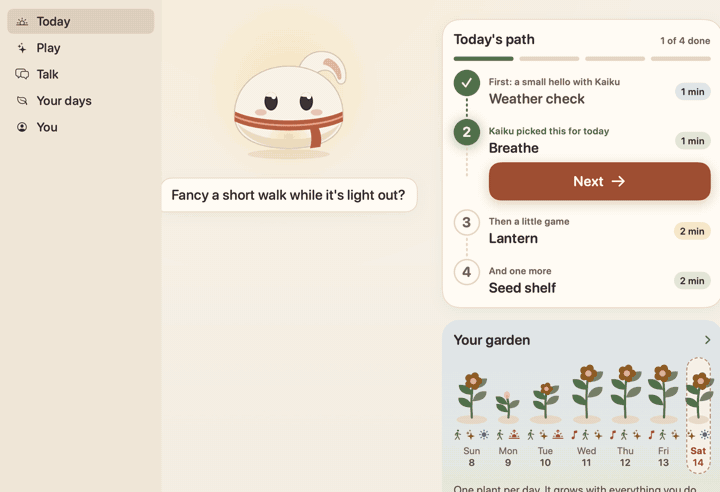<br><sub><b>Mac</b><br>In-app renders of the real Mac screens, stepped through (not a screen capture)<!-- MAC-GIF-CAPTION --></sub></td>
</tr>
</table>

<p align="center"><sub>iPhone clips are recorded on the iPhone simulator against a local service holding the simulated record, without sound. In the three conversation clips (the check-in chat here, the hard day and Talk below) her lines are typed with the microphone off, and every reply is Gemini Live's own answer in that take; the other iPhone clips make no model calls. The dashboard clip is the public deployment with its cached Gemma review.</sub></p>

## The problem and the idea

A TMS (transcranial magnetic stimulation) course means around twenty clinic visits, so for weeks someone sees
the person almost every day. When the course ends, that daily view ends with it, and the benefit can fade.
Depression also takes away the initiative to open an app and report; one questionnaire or one wearable is a
thin signal.

Kaiku reaches out first: a desk robot with a three-minute morning ritual, an iPhone and Mac app with short
games and a voice to talk to, and that same voice in the glasses on a walk. Each kind of everyday signal is
compared with the person's **own usual**, a fixed, readable rule combines them into one **consensus**, and a
practitioner sees on one page who is worth a check-in, and why.

## How it works

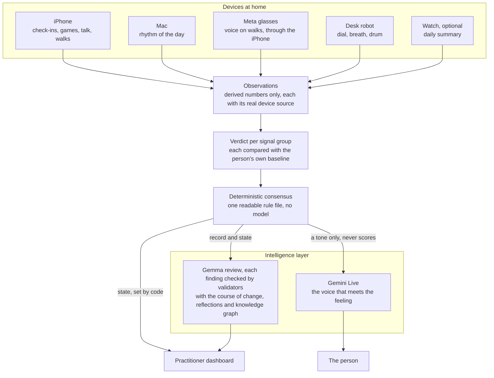

- **Signal groups, not devices.** Check-ins and robot, walks and outings, apps, and an optional watch summary. Several can come from one phone, so every record keeps its real device source.
- **Code sets the state.** [`config/criteria.toml`](config/criteria.toml) is the whole rule, versioned by hash. No model decides a person's state or handles a crisis.
- **Models interpret and speak.** Gemma chooses evidence and words the practitioner review; code checks every citation and renders every number. Gemini Live speaks from a small prepared card (memories she chose to share, today's activities, a tone) and never sees scores or states ([D35](docs/decisions.md)).

| Consensus | When |
|---|---|
| **Stable** | Enough data, nothing worse than usual, and at least 21 days of record |
| **Watch** (worth a check-in) | One signal group worse than her usual, or too little data: shown as "not enough data", never as stable |
| **Needs a call** | Two or more signal groups worse than her usual |
| **Safety** | PHQ-9 item 9 or a crisis phrase; overrides everything, with a fixed script and no model |

### One sentence through the mind

<p align="center">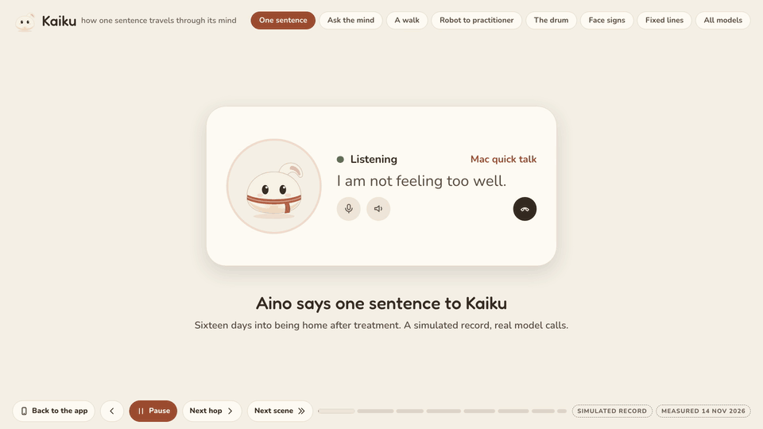<br><sub>The whole flow in 70 seconds: seven scenes, 35 hops, then every model. At each gate: what crosses, what stays behind, how long it took. Simulated record, real model calls, measured 14 Nov 2026.</sub></p>

<p align="center">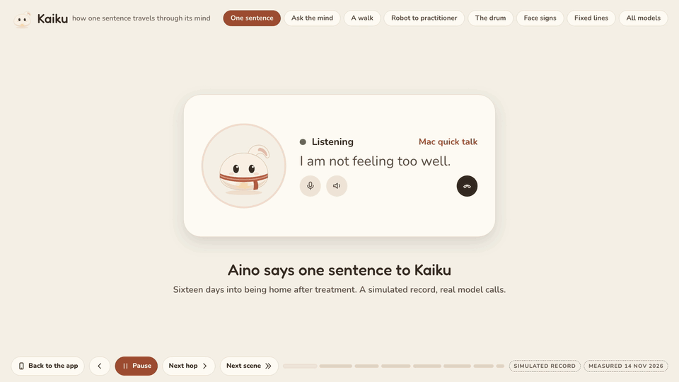<br><sub>One scene at reading pace: "I am not feeling too well", from the Mac to Gemini Live, to Kaiku's rules and back.</sub></p>

[`docs/explainers/intelligence-flow.html`](docs/explainers/intelligence-flow.html) is the interactive version (open the file in a browser): seven scenes and a table of every model. The scenes: one sentence, a question to the mind, a glasses walk, the robot's ritual to the practitioner, the drum game, face signs, and the fixed lines.

| Model | When Kaiku uses it | Measured (runs) |
|---|---|---|
| Gemini Live (`gemini-3.8-live`) | Every spoken conversation; hears her, speaks as Kaiku, chooses the tools | 2.3 s to first sound (5 turns) |
| Gemma 4 (`gemma-4-26b-a4b-it`) | First to reason behind `ask_mind`; writes the practitioner review; every answer checked by code | 2.3 s `ask_mind` (5), 18.1 s review (8) |
| Gemini 3.8 Flash | Fallback only, after Gemma fails twice | 3.4 s (1) |
| Gemini 4 Argon | Escalation for hard questions (at most 20 a day per home), the weekly brief | 4.6 s (1), 7.7 s brief (6) |
| Gemini Embedding 2 | A vector for each note she lets Kaiku keep, and for a question | 341 ms a note (108) |
| Gemini TTS | The fixed lines in Kaiku's one voice, rendered once and cached; never the crisis script | 4.1 to 4.5 s, then 5 ms |
| Lyria RealTime (`lyria-realtime-exp`) | The robot's drum game, Tap it back: a short song at a set tempo, straight from the hub; off unless the hub's music is switched on | 0.38 to 0.71 s to open (2), 8.7 s once |
| No model | Her state, the crisis path, the context card, the `feel` plan, the spend cap, every validator | 20 ms ingest and rule (3) |

The conversations were held by a test client standing in for the apps (same session route, token, Live connection
and tool route) with a synthetic voice. In those five turns the voice chose `feel` and `recall` and never
`ask_mind`; the `ask_mind` numbers come from questions sent to the same route.

## A companion, not a reporting machine

<table align="center">
<tr>
<td align="center" valign="top">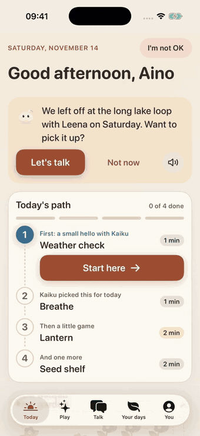<br><sub>A hard day (simulator, typed lines, real Gemini Live replies, no sound): Kaiku stays, offers sitting quietly together once, and answers her last line on the Lock Screen</sub></td>
<td align="center" valign="top">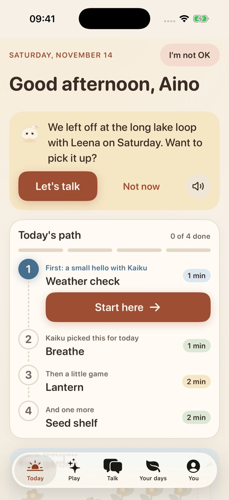<br><sub>Today: one invitation, from something she said</sub></td>
<td align="center" valign="top">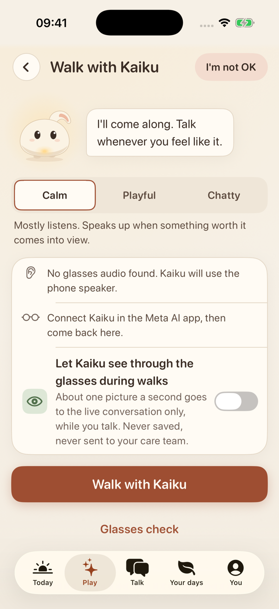<br><sub>A walk: Calm, Playful or Chatty</sub></td>
</tr>
</table>

- **It notices and acts.** When what the person says, or how they say it, carries a clear feeling, the voice tells Kaiku's mind once (the `feel` tool, non-blocking, so the talk never stalls). The answer is a small plan: how to meet it (comfort, celebrate, explore, give space), whether to keep the chat brief or stay, one thing the record knows helps this person, and at most one offer per conversation. Good news gets gladness. A heavy day gets company before any suggestion.
- **The check-in is a small chat.** Today's first stop opens with Kaiku's hello, like meeting on the street. Answer by voice, by typing, or turn the three dials underneath; all three count. An ordinary day closes in a few turns; a really good or really hard one goes on as long as the person wants.
- **A suggestion comes as a card.** When Kaiku suggests a game, a journal entry, breathing or a walk, it makes a tool call that puts one card in the conversation. Nothing opens without the person's yes, and a no is final for that conversation.
- **One mind on every device.** A favourite place mentioned on a glasses walk is known to the phone, the Mac and the robot the next time ([tested](cloud/tests/test_walk.py)). Once a day Kaiku may bring one thing up on Today, chosen by rule and worded around her own words.
- **Agreed in one place, shown everywhere.** When she says yes to an activity on the robot, the glasses or in any talk, Kaiku's cloud keeps it for the day and every screen shows the same thing: a card on Today, a notification when the app is behind or the phone is locked, "Done" everywhere once the activity's own record arrives. Code decides what counts as her yes; "maybe" keeps nothing, and on an extra-gentle day only her own ask is kept. An open app has it in well under a second (7 to 39 ms on one machine); a phone that has put the app to sleep shows it when the app is next opened (Kaiku sends no Apple push; that was considered and left out).
- **None of this sets the state.** The consensus stays code. The plan shapes a conversation; it never changes what the practitioner sees as the state.

<p align="center">
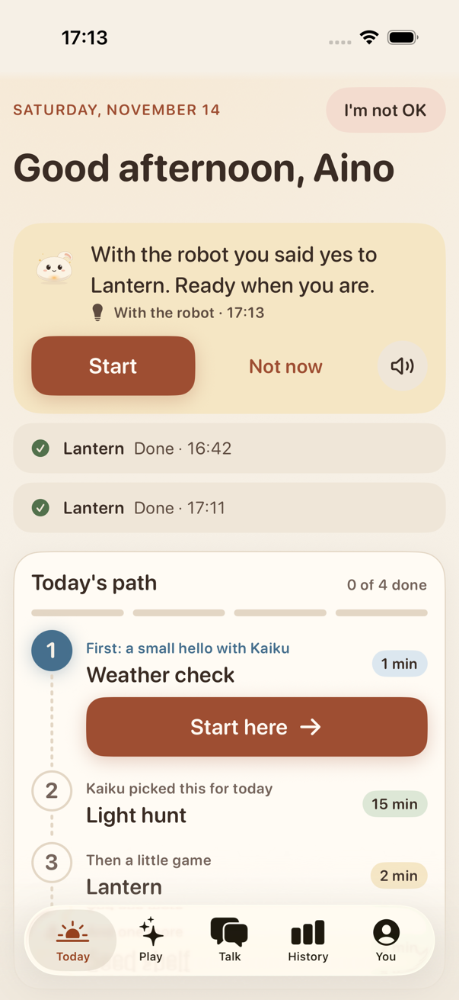
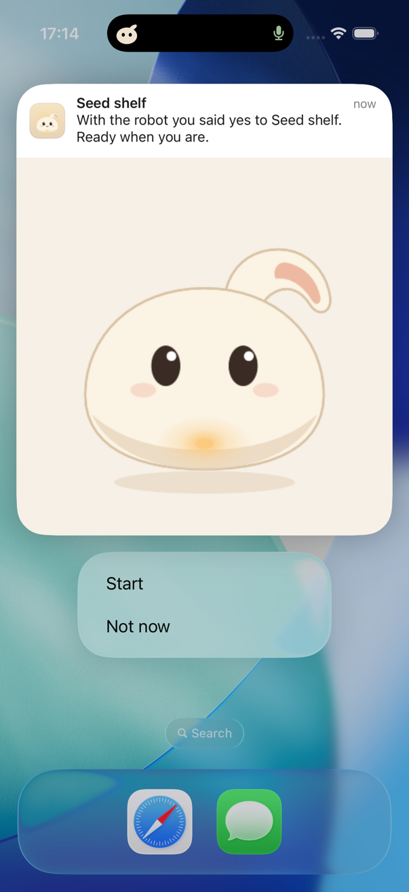
<br><sub>A yes posted as the robot's tool call: the card on an open Today, and the notification with the app behind (iPhone simulator, a real stream).</sub></p>

**Where it stands:** shown with real Gemini Live replies to typed input on the iPhone simulator. An ordinary day
closed in three turns, by Kaiku. On a hard day (the clip: her mother's ninetieth birthday) Kaiku stayed, made one
offer and kept answering after the phone was locked. In one earlier take it gave no reply to two plain
statements. That did not happen again in three later real runs of the same lines (four of four answered each
time), so its cause is not known; the app now notices a line that gets no answer, checks the connection and
sends the line again. Not yet heard through a real microphone. The agreed card was shown on the simulator from
posted tool calls, and once from a real typed Gemini Live walk where Kaiku itself made the call; a spoken yes to a
real robot, and the Mac's own banner, have not been shown.

## The surfaces

### iPhone

<table align="center">
<tr>
<td align="center" valign="top">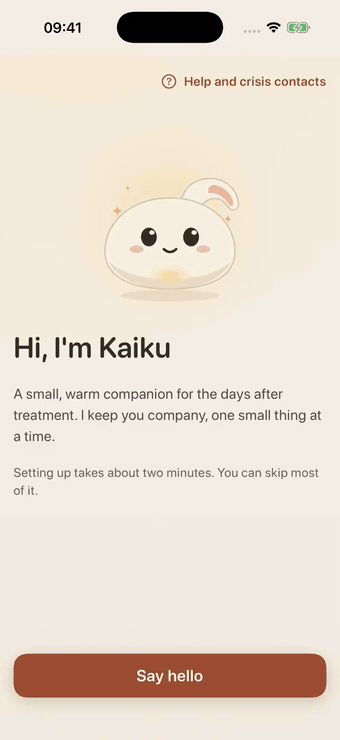<br><sub>First-run setup to Today (iPhone simulator)</sub></td>
<td align="center" valign="top">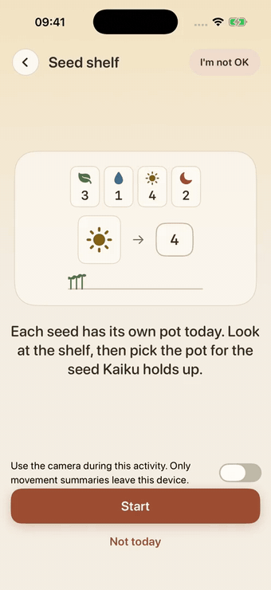<br><sub>Seed shelf, a measured game</sub></td>
<td align="center" valign="top">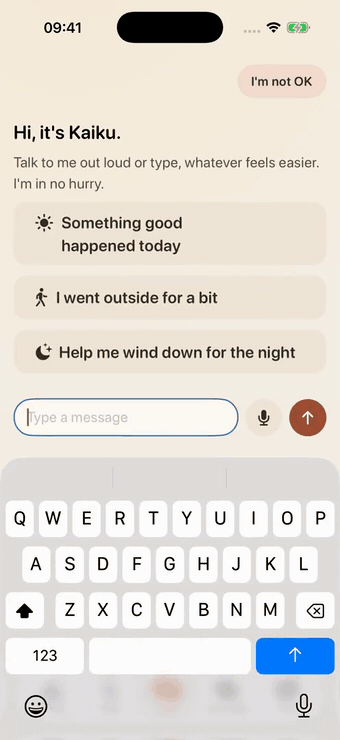<br><sub>Talk is a call (simulator, typed lines, real Gemini Live replies, no sound): Kaiku muted for one answer, which still comes as captions; then the phone locked, the reply on the Lock Screen bar, and "End" there</sub></td>
<td align="center" valign="top">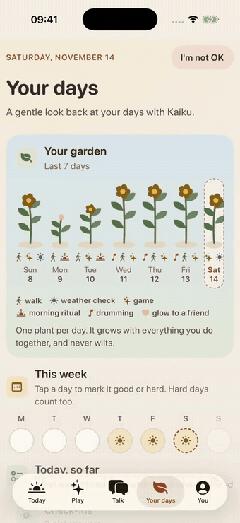<br><sub>"Today, so far" under History (what was noticed, from which device, what is shared)</sub></td>
</tr>
</table>

- **Three minutes a day.** Today's path is a small check-in chat with Kaiku, its one suggestion, the Lantern game and one more game in turn. Games end on what grew, never a time or a count; they are short activities inspired by research, not validated tests ([games](docs/validation.md#games)).
- **Talk is a call.** One voice everywhere: a Gemini Live call opened with a short-lived token from the cloud, so the app never holds the API key. Mute yourself or mute Kaiku, independently; the words of both keep coming as captions. The call goes on when the phone locks, with a bar on the Lock Screen and in the Dynamic Island (elapsed time, the last caption, mute, end), and ends by itself after three quiet minutes in the background. If the voice is unavailable Kaiku stays silent and shows text, never a synthesizer.
- **History: her own numbers.** One tab holds everything Kaiku has collected about her, from every device: the robot's drum tempo, taps and steadiness, the morning ritual and first hello, each game's result, walks, check-ins, the watch and the Mac. Each measure opens by day, week or month with the average, the range and a band for her own usual range, and the single sessions under it. Numbers only: no state, no verdict, and seeded readings say "Simulated". From Apple Health, when she allows it (D53): the night's sleep with its deep, REM and core stages and the time awake, resting and walking heart rate, steps, distance walked and time in daylight, as daily totals; no sleep score, because Apple gives apps none. The new ones are shown, not scored.
- **Face signs, as numbers (D52).** With "Camera during activities" on (off by default), the iPhone or Mac counts how the face moves while a game or a check-in is on screen: smiles, blinks, range of expression. Apple's face tracking does it on the device; only the counts are sent, no picture is kept or sent, and nothing labels an emotion. A chip shows when the camera is on, with a one-tap off. The counts sit in History and beside the practitioner's record as shown, not scored: they never change the consensus. On a day when they are clearly below her own usual Kaiku goes a little gentler and never says why.
- **Her choices, her day.** Every signal has its own switch, set at first run and reversible. "Today, so far" lists what was noticed, from which device and what is shared. Readings queue on the phone until the cloud confirms them.

<p align="center">
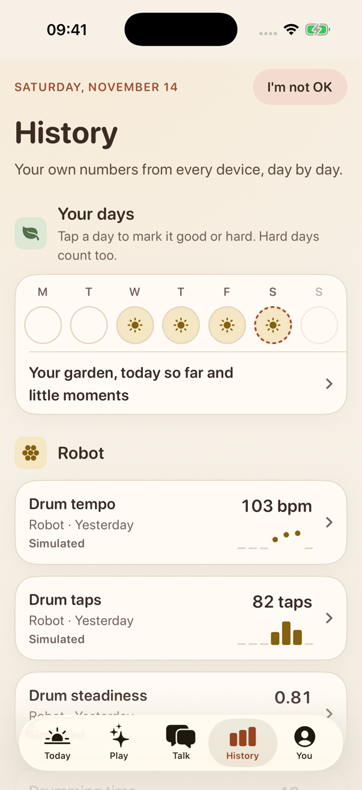
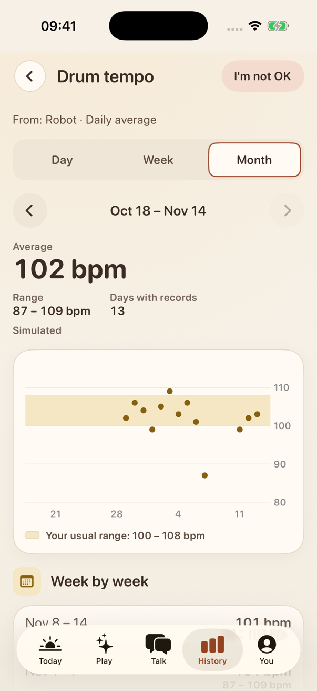
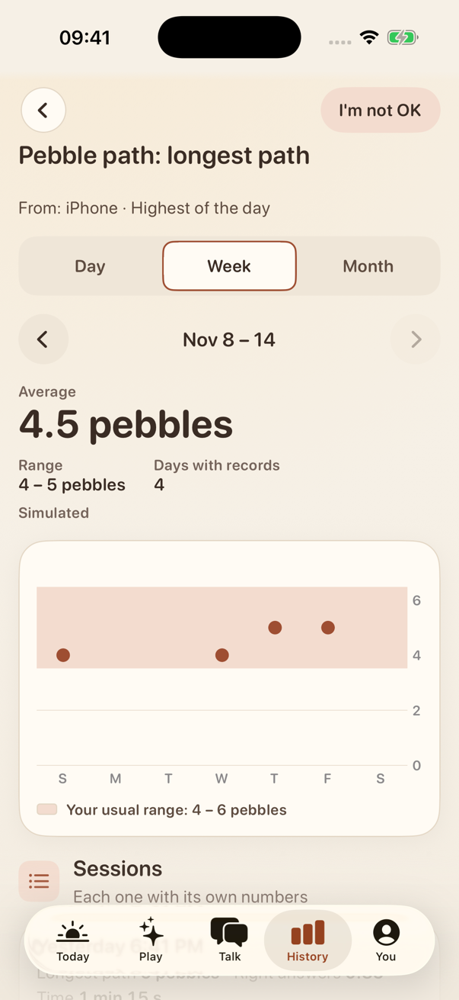
<br><sub>History (iPhone simulator, the seeded record through the real route): the summary, the robot's drum tempo over a month, a game by week.</sub></p>

**Where it stands:** a signed build is installed on a real iPhone and found the service from the phone. On the
simulator, with typed input, a real call ran 4 min 48 s across a token renewal while locked, answered from the
Lock Screen caption, and was ended from the Lock Screen. A real microphone, Kaiku's voice while locked, and
Apple Health are not yet accepted on the device. [`apps/apple/AGENTS.md`](apps/apple/AGENTS.md)

### Mac

<p align="center"><br><sub>In-app renders of the real Mac screens, stepped through (not a screen capture)<!-- MAC-GIF-CAPTION --></sub></p>

- **The same Kaiku on the desk.** One Swift package holds every screen and game; the Mac and iPhone targets are thin shells around it.
- **Rhythm, never content.** Opt-in and pausable: the frontmost app is mapped to a broad category on the Mac, and one message an hour carries minutes per category, late-night minutes, switches and breaks. Never window titles, URLs, keystrokes or screenshots; the contract rejects extra fields.
- **History on the desk too.** The same History pane as the phone, from the same route, two cards to a row.
- **A quiet nudge from the notch.** After 01:00 while still active, or after 90 active minutes without a break, Kaiku peeks from the notch with one line: at most three a day, with a snooze.
- **Quick talk from any app.** A thin bar rests at the left edge of the screen. Hover and it becomes two buttons: start speaking, open Kaiku. Tap Control twice (or Option-Shift-Space) and it grows into a small popup with Kaiku and live captions, and the conversation starts at once without taking focus from the app in front. Mute yourself or mute Kaiku; the captions keep coming. Tuck the popup away and the call lives in the notch with its elapsed time.

<p align="center">
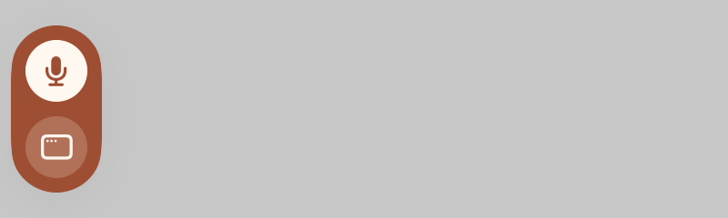
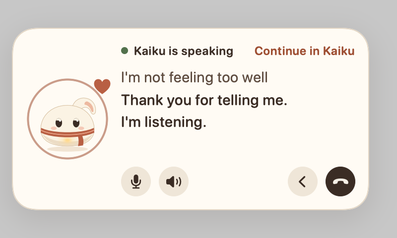
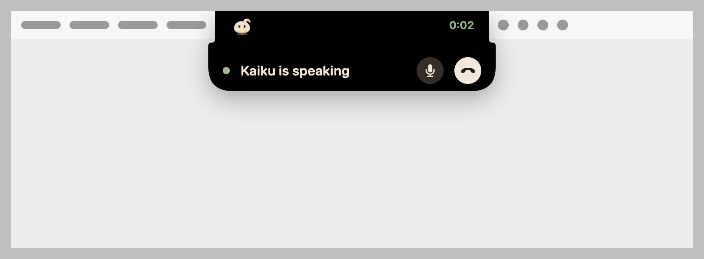
<br><sub>Quick talk: the bar on hover, the popup, and the call in the notch. Rendered from the app's own views, not a screen capture.</sub></p>

**Where it stands:** the Mac target builds; a simulated late evening produced the peek and its hourly record
on a local service. Quick talk is unit-tested and rendered in every state, and both triggers were shown to need
no Accessibility or Input Monitoring permission; nobody has yet pressed the keys in the running app or spoken to
it. The clip above is rendered in-app, not captured from the screen. [`apps/apple/AGENTS.md`](apps/apple/AGENTS.md)

### Meta glasses walk

<table>
<tr>
<td align="center" width="230">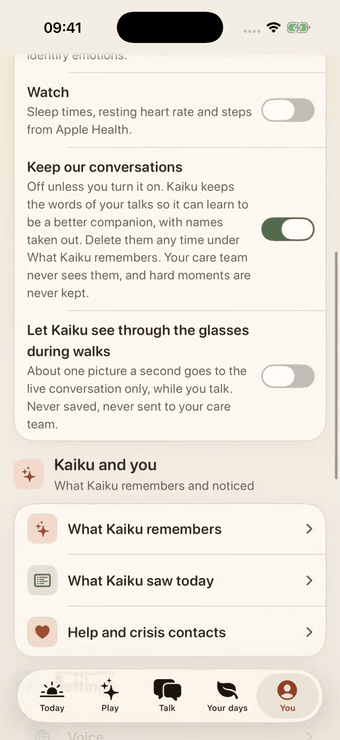<br><sub>You → Glasses check and its self-test on the simulator with no glasses connected. Real-glasses footage is pending.</sub></td>
<td>

- **A voice in the ear, head up, hands free.** The iPhone registers with the glasses through Meta's Device Access Toolkit. Kaiku's voice travels over ordinary Bluetooth, so the conversation that started in the kitchen continues on the street.
- **The walk survives the glasses.** Glasses off or out of range: the walk continues on the phone, and the record says so.
- **Company, in the style she chooses.** Calm mostly listens and speaks up only when something worth it comes into view. Playful sets small spotting goals ("two more to find": the phone keeps the count, Kaiku only says it) and asks a little about her day. Chatty keeps the talk going. A sad sentence drops the game in any style.
- **It connects what it sees to what it knows.** Her outdoor favourites travel with the walk, so a view can become "Is that your favourite tree up there?". It asks rather than asserts, because a model cannot know it is that tree. A new favourite is kept only from her own words.
- **Seeing is a separate opt-in (D43).** With "Let Kaiku see through the glasses during walks" on (off by default), about one camera frame a second goes to that walk's Gemini Live conversation and nowhere else. With it off, Kaiku says it cannot see.

</td>
</tr>
</table>

**Where it stands:** on real Gen 2 glasses in Developer Mode (15 Nov), with the phone as a Personal Hotspot, the
Glasses check's self-test passed its three steps: Kaiku's line played in the glasses, the glasses microphone heard
the wearer, and a camera frame arrived over Bluetooth. A walk with seeing on then sent 30 frames in 40 seconds to
its Gemini Live conversation, and Kaiku heard the wearer through the glasses and replied twice; its voice was
muted in the app for that walk, so the walk's replies have not yet been heard in the glasses. What Kaiku says
about a real view is shown so far with Meta's Mock Device Kit and real Gemini Live calls: stock landscape pictures
as the view (a dull road got no words in any style, a lone tree got the question above) and one three-minute walk
on the simulator with typed lines. The rest of the five-minute test is [`docs/glasses-test.md`](docs/glasses-test.md). The integration lives in
the iPhone app ([`apps/apple/AGENTS.md`](apps/apple/AGENTS.md)); the two `apps/glasses-*` folders hold instructions only.

### Robot

No clip of the robot in this README yet.

- **It speaks first.** A three-minute morning ritual with no typing: three turns of an ear dial for mood, energy and sleep, one guided breath while the chest glows, and a short rhythm tapped on its head. The drum is inspired by research on improvisational music therapy; the chest light is not light therapy.
- **Ran on the hardware twin.** The whole hub-driven ritual, its crisis gate and the upload of derived numbers run against software twins of the head and sensors over real MQTT (`make sim`, `make hub`). The twins speak the same messages as the boards, and their records are marked simulated.
- **Ran on the boards.** The Atech head ran the full ritual by knob, without a laptop, on its standalone firmware (D44). Over MQTT its knob and button, and the UNO Q's face camera, distance, room light and buzzer, were seen on the broker. On 14 Nov the head as built (no display, taps from its orientation sensor, D54 and D55) ran firmware `atech-head-standalone-0.4.0` on the laptop's broker beside the UNO Q, and the hub switched to follow mode with voice and music routed to the head.

- **The head's ritual reaches the record.** In follow mode the hub shadows the standalone head: its dial answers become mood, energy and sleep check-ins and the knocks become a drum session, queued for the cloud and shown in the practitioner's daily account. The hub sends the head no commands, so the two never compete.

**Pending on the physical head:** the whole follow-mode ritual with Gemini Live and Lyria is proven against a
software twin of the standalone firmware. On the board itself (15 Nov) a press opened a Gemini Live
conversation and the ritual completed; in a later run, with a phone as the microphone, her spoken yes to a question asked through the head's speaker arrived as a tool
call. Nothing from the physical robot has been shown on the
dashboard yet, the newest behaviour (asking twice, a press opens a talk) has not been tried by a person on the
robot, and pulse stays "not measured". What is fitted: [`docs/stack/atech.md`](docs/stack/atech.md).
Bring-up steps: [`hub/AGENTS.md`](hub/AGENTS.md). Module docs:
[`hub/`](hub/AGENTS.md) · [`firmware/atech-head/`](firmware/atech-head/AGENTS.md) · [`firmware/unoq-sensors/`](firmware/unoq-sensors/AGENTS.md) ·
[`sim/`](sim/AGENTS.md) · [network handover](docs/robot-network-handover.md)

### Practitioner dashboard

<p align="center"><a href="https://harrish21raj--kaiku-web.us-east.modal.run/?id=aino"></a><br><sub>The practitioner dashboard on the public simulated record · <a href="docs/media/web-dashboard.png">full-size still</a></sub></p>

- **One page, one person.** A header strip with the consensus in plain words, then nine movable panels: trends against her usual range, consensus now, Kaiku's review, knowledge graph, daily account, routine, care actions, ask the record, and coverage.
- **A map of her days, not a diagram.** The knowledge graph puts every measure, activity and routine in its neighbourhood (mornings, sleep and body, mood and energy, movement, people, screens and games, care) and lets the practitioner scrub through the days: what was recorded, what was away from her usual, what changed that day and what moved first. Order in time is stated; cause never is.
- **A review that can be checked.** Gemma writes the overview and findings; code renders the numbers, and each finding opens the records it cites. A second tab shows the agent trace: every step, whether a rule or a model ran it, validator rejections and fallbacks.
- **Honest about its sources.** Each signal group shows which device actually sent its records and a "Simulated" marker. Care actions are recorded in Kaiku and contact nobody. Conversation words are never shown.

<p align="center">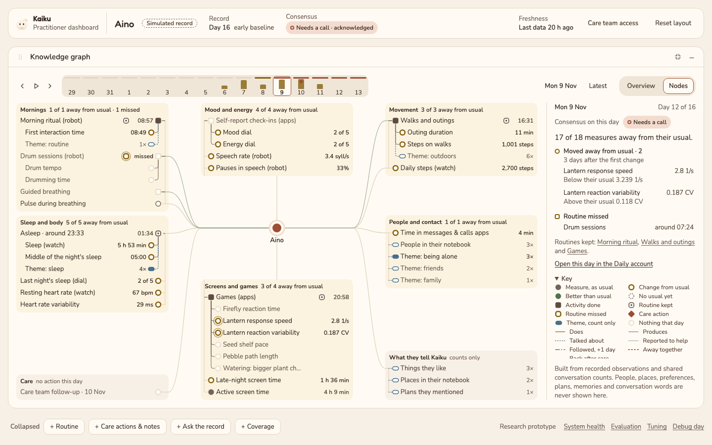<br><sub>The knowledge graph on 9 Nov, the day the call was raised: 17 of 18 measures away from her usual, and what changed that day.</sub></p>

**Where it stands:** live at the public link, read-only, with one simulated record. Seen in one browser engine
(headless Chromium). For the team there is also a debug page per day: everything collected that day, each rule's
reading, every model call, and Gemma's read of the day with each sentence checked against the facts it cites.
[`apps/web/AGENTS.md`](apps/web/AGENTS.md)

### Cloud on Modal

- **One deployed app.** A single warm container serves the API and the dashboard from one URL, with SQLite on a Modal Volume ([`cloud/app.py`](cloud/app.py)). It accepts derived observations only and rejects anything else.
- **Scheduled and parallel work.** The same file schedules a recompute every 15 minutes, a nightly run and a weekly brief, and fans a simulation of 72 synthetic people out over 8 shards with `.map()`.
- **Gemma, plainly placed.** Reviews run through Google's hosted API (`gemma-4-26b-a4b-it`). A separate scale-to-zero GPU app ([`cloud/gemma_app.py`](cloud/gemma_app.py)) serves the same model with vLLM on a Modal H100 behind one switch: on 15 Nov it wrote the practitioner review (5.2 and 10.5 s warm, after a 235 s cold start) and answered a record question, called from a local API. It is not the public demo's default path.

**Where it stands:** the public URL was checked from outside (dashboard open, admin routes closed without a
token). Every Modal feature we use, and why: [`docs/stack/modal.md`](docs/stack/modal.md) · [`cloud/AGENTS.md`](cloud/AGENTS.md)

## Try it

**Nothing to install:** open the [public simulated record](https://harrish21raj--kaiku-web.us-east.modal.run/?id=aino).
It is one authored person, Aino, read-only.

**On your machine:** needs macOS or Linux, [uv](https://docs.astral.sh/uv/), and Node 20 + pnpm for the
dashboard pages. mosquitto is only needed for the robot and its software twins. No API key is needed to see
the dashboard.

```bash
git clone https://github.com/Harrishayy/kaiku.git && cd kaiku
make setup     # Python + web dependencies, creates .env from .env.example
make doctor    # says what is missing and how to fix it
make demo      # broker + local API + dashboard + Aino's sixteen-day record; prints the links
```

`make demo` is safe to run twice: it reuses an API or broker that is already up and adds nothing the second
time. It stays in the foreground; Ctrl-C stops what it started. Logs are in `logs/demo/`.

| Then | Command |
|---|---|
| Open the practitioner dashboard | `http://127.0.0.1:8000/` (the link `make demo` prints) |
| See today's recordings move the reading | `make live-day` (a good day and a rough day, on a throwaway copy) |
| Start over (the record ends yesterday again) | `make demo-reset` (drops simulated data, keeps live recordings) |
| Use another port or database | `KAIKU_DEMO_PORT=8010 KAIKU_DB_PATH=/tmp/kaiku.sqlite make demo` |
| Run the robot ritual on software twins | `make sim` and `KAIKU_VOICE=text make hub` in two more terminals |
| See how the rule behaves on synthetic courses | `make calibrate` (about 20 s) |

**The person in the record.** Aino, 58, comes home after a TMS course. Her simulated record holds sixteen days
and always ends yesterday, so today is open for live recordings. The states are not written into the data: the
real rule reads it. Days 1 to 10 the baseline is forming, on day 11 the first signal group is worse (worth a
check-in), on day 12 the daily signals alone raise "needs a call", and on day 13 the care team rings and she
fills in a PHQ-9. [`cloud/tests/test_single_person.py`](cloud/tests/test_single_person.py) pins those states day by day.

### Link your own iPhone or Mac

The apps normally create their own home on first run. To add live recordings to Aino's simulated record
instead, pair with the account link that `make demo` prints (`http://<this-mac>:8000/?home=aino`):

```bash
# iPhone: builds, signs, installs and launches the app with that link
KAIKU_TEAM=<apple team id> apps/apple/scripts/run_on_iphone.sh aino

# Mac app: build it, then launch the built app with the link
cd apps/apple && xcodegen
xcodebuild -project Kaiku.xcodeproj -scheme "Kaiku Mac" -destination "platform=macOS" build
<build products>/Kaiku.app/Contents/MacOS/Kaiku -kaikuPairLink "http://127.0.0.1:8000/?home=aino"

# Robot hub and software twins (from the repo root, two terminals)
KAIKU_HOME_ID=aino make sim
KAIKU_HOME_ID=aino KAIKU_VOICE=text make hub
```

The iPhone script needs Xcode, xcodegen, an iPhone paired with Developer Mode on, and `make demo` on its
default port 8000, on the same network as the phone. Keep the phone unlocked: the link is passed when the app
launches (`--install-only` installs on a locked phone and does not pair). A check-in, a game or a walk recorded
today is then compared with her sixteen days. Details: [`apps/apple/AGENTS.md`](apps/apple/AGENTS.md).

## Is it any good?

**On people: unknown.** Nobody has used Kaiku while unwell, so there is no measured sensitivity or specificity,
and we claim none. What we can measure is how the rule behaves on labelled synthetic courses from our own
generator: 40 synthetic people per course, 60 days, rule `consensus-v1+ef17c3f3`. Assumptions and every limit
are in [`docs/validation.md`](docs/validation.md); reproduce with `make calibrate`.

| On synthetic courses | Mild change (1 SD) | Moderate (2 SD) | Marked (3 SD) |
|---|---|---|---|
| Flagged within 21 days (worth a check-in), average of six kinds of course | 68 % | 96 % | 99 % |
| Reaches "needs a call", same average | 21 % | 71 % | 86 % |
| Days to flag, sudden drop that stays | 5 | 2 | 2 |
| Days to flag, gradual decline over 14 days | 12 | 7.5 | 6 |

- **People who are fine:** a mean of 0.08 false flags per person-week, about one unneeded "worth a check-in" per person every three months, and 0.00 to 0.01 false "needs a call" per person-week. A fine person still has a 15 % chance of some flag in any 3-week window.
- **A new record:** "not enough data" for days 1 to 8, a first flag possible from day 11 against an early baseline labelled lower confidence, and never "stable" before day 21. A moderate dip on days 9 to 12 is found by day 16 in 57 % of synthetic people (marked 83 %, mild 15 %).
- **What is weak:** no clinical validation; the numbers describe the rule, not people. Mild change is mostly missed at the "needs a call" level. Skipped check-ins hide a decline: for a moderate one, "needs a call" falls from 90 % to 53 %. Without the PHQ-9, a moderate drop reaches "needs a call" in 57 % instead of 85 %. PHQ-9 is the only validated instrument here. The "what helps" learner ranks what coincides with good days, not what works.

| Part | Real today | Simulated or pending a physical test |
|---|---|---|
| Cloud, consensus, dashboard | Deployed on Modal and checked from outside; 973 Python tests passed at the last logged merge | Every record is authored and marked simulated; thresholds are engineering defaults |
| Gemma | Reviews through Google's hosted API on the simulated record; the review and a record question also from our own vLLM on a Modal H100 (15 Nov) | Our own GPU is not the default path; no tuned weights |
| Gemini Live | Real Live calls with injected speech, typed turns (ordinary day, hard day, spotting game) and pictures as the walk's view | A spoken exchange on a real microphone |
| iPhone app | Signed build installed on a real iPhone; 309 Swift tests passed (11 skipped); a real typed call kept going while the simulator was locked | Microphone, Kaiku's voice while locked and Apple Health on the device |
| Mac app | Builds; a simulated late evening produced the notch peek and its hourly record; quick talk rendered in every state | Quick talk by real key presses and voice; a screen capture; real usage over days |
| Meta glasses | Registration and connection on real Gen 2 glasses (Developer Mode); a three-minute walk with Meta's mock glasses and real Live | Voice, head motion, walk styles and opt-in seeing on the real glasses: one filmed walk |
| Robot | Ritual by knob on the Atech board; knob, button, face camera, distance, room light and buzzer seen over MQTT; head, UNO Q and hub together on one broker in follow mode | A whole ritual on the physical robot with its records on the dashboard, Tap it back and Kaiku's voice heard from the head's speaker, the head's microphone, motor, pulse |
| People | Four logged sessions, all by the project lead | Testers outside the team; any clinical validation |

Sources: the dated audit [`docs/track-readiness.md`](docs/track-readiness.md) and the latest entries of [`docs/progress.md`](docs/progress.md).

## The stack, piece by piece

Six partner technologies carry Kaiku, and each one does work the others cannot. Every one has a page under
[`docs/stack/`](docs/stack/INDEX.md), written from the code: what we use and how, what has run with dates and
measured numbers, and whether it was the right choice.
[One sentence through all six](docs/stack/INDEX.md#one-sentence-through-all-six) follows a single morning from
the robot's camera to the practitioner's page.

### Gemini API: the voice that has hands · [full page](docs/stack/gemini.md)

- **Gemini Live on four bodies.** One voice on iPhone, Mac, Meta glasses and the robot. The apps speak to Live over a raw WebSocket with a one-use token minted by the cloud (locked to the model, five minutes, renewed mid-call between two sentences); the robot's hub uses `google-genai`.
- **Session features we lean on.** Barge-in, input and output transcription (captions, and the crisis gate reads them), voice activity tuned for slow speech (900 ms of silence), session resumption and sliding-window compression for 30-minute walks, proactive audio on walks only, one picture a second from the glasses.
- **Function calling does the work.** One registry of 18 tools. `feel` is non-blocking: the voice tells Kaiku's mind what it heard and code answers with a plan in about 5 ms, so the talk never stalls. Other calls move the robot's check-in, keep a walk's spotting game, put a card on the phone and reach Gemma (`ask_mind`).
- **Code decides what counts as her yes.** Every tool call passes the crisis gate and a schema; a memory must be grounded in her own words; "maybe" starts nothing; on the robot a model's call only arms the head and her own press starts the activity.
- **Six more models, one job each.** TTS in the same voice for fixed lines, cached; Embedding 2 for her notes; Lyria RealTime for the drum game; Flash and Argon as fallback and escalation behind Gemma; an image model for a walk's postcard.
- **Measured:** 2.3 s from the end of her speech to Kaiku's first sound (5 turns); a 4 min 48 s call across a token renewal while the phone was locked.

### Gemma: reasoning that can be checked · [full page](docs/stack/gemma.md)

- **Eight jobs.** The practitioner's review, questions to the record, the mind behind the voice, the nightly knowledge graph, the tone of a kept reflection, a look at a few check-in pictures, the consensus in words, and the team's read of one day.
- **The same pattern every time.** Gemma is given facts that code wrote, answers in a small structure, and code checks it. In the review a finding is rejected if it cites an unknown record, contains any number, claims a cause, names an emotion, or tells the practitioner what to do. For record questions Gemma returns only citation ids and its prose is never shown.
- **A trace on the dashboard.** Ten steps, each marked code, Gemma or template, with time taken and how many answers were rejected in which category.
- **Two routes, one switch.** Google's hosted API by default; our own vLLM on a Modal H100 behind `[gemma].provider`, verified on 15 Nov for the review (5.2 and 10.5 s warm) and a record question (2.2 s).
- **Never:** a state, a crisis, a number of its own, a feeling read from a face, an edit to her memories.

### Modal: the whole cloud in two files · [full page](docs/stack/modal.md)

- **One warm container, by design.** API, dashboard and SQLite on a Volume from one URL; `max_containers=1` with 50 concurrent inputs because SQLite has one writer. The Volume is committed after every write, and a failed commit answers 503 so the phone sends the reading again.
- **Schedules that cannot become a second writer.** A 15-minute recompute, a nightly run and a weekly brief call the container's own admin routes over HTTP; they never mount the Volume.
- **`.map()` over synthetic people.** 72 people in 8 shards replay the real rule day by day; the result sits beside the rule editor.
- **Gemma on an H100, scale to zero.** vLLM in a GPU class, weights pulled into a Volume by a CPU function. A cold start took 215 to 235 s, so the caller shows deterministic text and deliberately leaves the cold call running: the next question is answered by Gemma. Every GPU call is costed in a spend ledger before it runs.

### Meta AI glasses: a walk, head up · [full page](docs/stack/meta-glasses.md)

- **Device Access Toolkit 1.0.1 on iOS.** Explicit registration through the Meta AI app, a device session with every state worded on screen, the camera stream (360 × 640), head motion at 30 Hz, and worn or not from the device state.
- **Hands-free Bluetooth for the voice.** Chosen because it is the only route that gives the glasses' own microphone; the Live session's voice activity is tuned for it.
- **Seeing is a second opt-in.** At most one picture a second, straight to that walk's Gemini Live session and to no Kaiku service, behind five gates; the screen counts pictures sent and Kaiku says "I cannot see" whenever no frame is flowing.
- **The walk survives the glasses.** Session lost, Bluetooth lost or glasses taken off: the walk continues on the phone and Kaiku is told.
- **On real glasses (15 Nov):** the self-test passed speaker, microphone and camera frame, and a walk sent 30 frames to its Live conversation.

### Atech: a head that works alone, and better together · [full page](docs/stack/atech.md)

- **One 14-port board, five modules.** An ear dial, an orientation sensor that feels taps (0.15 g above rest, muted while the motor or speaker runs), a neck motor, a speaker and a microphone.
- **Standalone first.** The head runs the whole check-in by knob with no laptop; the hub shadows it and writes the record, and never fights it for control.
- **A live voice over MQTT.** Kaiku's Gemini Live voice and Lyria's music reach the head's speaker as 20 ms audio frames; a press of the ear opens a talk.

### Arduino UNO Q: eyes that keep the picture · [full page](docs/stack/arduino-uno-q.md)

- **Both halves used.** The Linux side reads a USB camera and turns each frame into numbers on the board (face position, distance, room light); the microcontroller plays the chimes; Arduino's Bridge joins them.
- **Only numbers leave the board,** and the camera device is closed unless she said yes in this conversation.
- **Board to board.** A face seen by the UNO Q wakes the Atech head through the broker, with no hub in between.

## What each jury can click or see

| Challenge | What we show | Proof |
|---|---|---|
| **Aalto**<br>Beyond the Clinic | Sense, respond, learn: four signal groups against her own usual, a fixed consensus, a practitioner page, a learner that favours what she responded to. | [The public dashboard](https://harrish21raj--kaiku-web.us-east.modal.run/?id=aino) · calibration in [`docs/validation.md`](docs/validation.md) |
| **Gemini API** | Gemini Live is Kaiku's one voice on phone, Mac, glasses and robot, with tool calls that move a ritual and a walk. Short-lived tokens, TTS, embeddings. | Real Live call with injected speech and a picture; the Talk tab in the app |
| **Gemma** | Gemma 4 chooses evidence and words the review; code validates each finding and renders every number. | [Dashboard](https://harrish21raj--kaiku-web.us-east.modal.run/?id=aino) → Kaiku's review → Agent trace (10 steps) |
| **Modal** | API, dashboard and database served from one deployed app; scheduled analytics; a parallel simulation of synthetic people; a scale-to-zero GPU class for Gemma. | [The demo URL](https://harrish21raj--kaiku-web.us-east.modal.run/?id=aino) on slide 1 · one cold Gemma call on a Modal H100 (default stays the hosted API) |
| **Meta**<br>AI glasses | Audio-first walk companion through the Device Access Toolkit; opt-in seeing; the walk survives the glasses coming off. | On real glasses: registration, the Glasses check self-test (speaker, microphone, camera frame) and a walk that sent 30 frames to Gemini Live · [page](docs/stack/meta-glasses.md) |
| **Atech**<br>Real World | The robot's head on one 14-port board with five modules (ear dial, orientation sensor for taps, neck motor, speaker, microphone), on MQTT with the hub and the UNO Q. | On the board: the ritual by knob with no laptop, taps, motor over MQTT, a Gemini Live conversation through its speaker with a phone as microphone · [page](docs/stack/atech.md) |
| **Arduino**<br>UNO Q | The robot's eyes: camera numbers made on the board, chimes from the microcontroller, a face that wakes the Atech head. | On the board: faces, distance, room light and chimes on the broker · [page](docs/stack/arduino-uno-q.md) |

The first four rows are as on slide 10 of the [deck](demo/deck/kaiku-deck.pdf); the Meta, Atech and Arduino rows
are newer than the deck. Details for every row: [`docs/stack/`](docs/stack/INDEX.md).

## Safety and privacy

- **The crisis path is deterministic and contacts nobody.** A fixed phrase list, PHQ-9 item 9 or a long press on the robot's button shows a pre-written message with the MIELI Crisis Helpline 09 2525 0111 and 112 and sets "Safety" on the dashboard. It will miss indirect language. [`docs/safety.md`](docs/safety.md)
- **No raw media is stored.** Only derived numbers reach the record and the cloud rejects anything else. Audio goes to Gemini Live only during a conversation she started; Google can keep Live session state for up to 24 hours. [`docs/privacy.md`](docs/privacy.md)
- **The glasses-frames rule (D43).** Off by default. Frames may go to that walk's Gemini Live conversation and nowhere else; no state, observation or crisis trigger comes from a picture, and people in view are never described. [`docs/decisions.md`](docs/decisions.md)
- **Camera during activities (D52).** Off by default. Counts of face movement per game or check-in are made on the device and only those numbers are sent; no picture leaves it and no emotion is inferred from a face anywhere in Kaiku. The idea comes from research on reduced facial movement at higher symptom severity; it is not validated here and every level is uncalibrated, which is why the counts have no vote. [`docs/validation.md`](docs/validation.md)
- **Consent per signal.** One switch per signal, pausable, listed in "What Kaiku saw today". Conversation text is kept only after a separate opt-in, and practitioners never see conversations or the notebook.
- **A research prototype.** Not a medical device, not a crisis service, and no replacement for clinicians. It reports a change from a person's usual; a practitioner decides what that means.

## Repo map

Every module has one doc, its `AGENTS.md`. New here? Read the root [`AGENTS.md`](AGENTS.md) first.

| Module | What it is |
|---|---|
| [`contracts/`](contracts/AGENTS.md) | Message envelope, payloads, topics, API models, signal-group map: the only shared package |
| [`hub/`](hub/AGENTS.md) | Robot orchestrator: perception, ritual state machine, safety gate, Gemini Live adapter, uplink |
| [`cloud/`](cloud/AGENTS.md) | Modal app: ingest, SQLite, baselines, verdicts, consensus, learner, Gemma review and graph, simulation, web hosting |
| [`apps/web/`](apps/web/AGENTS.md) | Next.js practitioner dashboard |
| [`apps/apple/`](apps/apple/AGENTS.md) | SwiftUI iPhone and Mac apps: Today, Play, Talk, History, You; the glasses walk |
| [`apps/glasses-webapp/`](apps/glasses-webapp/AGENTS.md) | Instructions only for a glasses display web app; not part of the entry |
| [`apps/glasses-dat-android/`](apps/glasses-dat-android/AGENTS.md) | Instructions only for an optional Android camera app; not part of the entry |
| [`firmware/atech-head/`](firmware/atech-head/AGENTS.md) | Atech board: knob ear dial, lid button, neck motor, speaker and microphone, taps from the orientation sensor (no display on this robot) |
| [`firmware/unoq-sensors/`](firmware/unoq-sensors/AGENTS.md) | Arduino UNO Q: camera (faces, distance, room light, pulse), buzzer chimes |
| [`firmware/friendlink/`](firmware/friendlink/AGENTS.md) | LoRa friend lamp, a stretch idea; not in the demo |
| [`sim/`](sim/AGENTS.md) | Software twins of every hardware node, synthetic people, cloud seeder |
| [`tools/`](tools/AGENTS.md) | Bus tail, record and replay, doctor, sync checkers, companion evals |
| [`config/`](config/AGENTS.md) | `criteria.toml` (the rule), `kaiku.toml` (settings), persona, voice lines, safety phrases |
| [`design/`](design/AGENTS.md) | Look ground truth: tokens, mascot spec and generated assets, motion |
| [`hardware/`](hardware/AGENTS.md) | CAD with provenance, wiring, bill of materials |
| [`demo/`](demo/AGENTS.md) | Table demo checklist, video shot list, deck, reset script |
| [`docs/`](docs/AGENTS.md) | Progress log, decisions, safety, privacy, tracks, validation, submission text, and [one page per partner technology](docs/stack/INDEX.md) |

## Team and licence

Built at Junction 2026 (Espoo, 13 to 15 November 2026) by **Harrish, Edwin and Xavier**.

[MIT](LICENSE). All code was written during the event. Third-party services, models and hardware keep their own
terms ([Gemini API](https://ai.google.dev/gemini-api/terms), [Gemma](https://ai.google.dev/gemma/terms), Modal,
the Meta Wearables platform, Atech). CAD provenance: [`hardware/AGENTS.md`](hardware/AGENTS.md).
