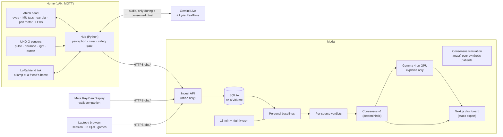

<div align="center">

<!-- MEDIA: hero image or looping GIF of the robot greeting someone. Uncomment when recorded.

-->

# Kaiku

*kaiku*: Finnish for "echo"

**A friend on your desk, a voice in your ear, a quiet eye on your days. Kaiku notices how you're really doing
after depression treatment, and tells your care team when it matters.**

[](https://hackjunction.app/)
[](#aalto-university--beyond-the-clinic-main-challenge)
[](#best-use-of-gemini-api)
[](#best-use-of-gemma)
[](#best-use-of-modal)
[](#meta--ai-glasses-for-everyone-everyday)
[](#atech-real-world-challenge)
<br>
[](pyproject.toml)
[](apps/web/)
[](contracts/)
[](LICENSE)

**[Demo video (2 min)](#demo-video)** · **[Live app](#live-app)** · **[How it works](#how-it-works)** ·
**[Run it](#run-it)** · **[Tracks](#tracks)** · **[Submission](docs/submission.md)**

</div>

> [!IMPORTANT]
> Kaiku is a research prototype built in 48 hours. It is **not a medical device** and **not a crisis service**,
> and it does not diagnose anything or predict relapse. It reports *change from a person's usual* to their care
> team. In Finland: **MIELI Crisis Helpline 09 2525 0111** (24/7), emergencies **112**.

---

## Demo video

<!-- MEDIA: replace the line below with the final YouTube/Vimeo link (public, ≤ 2:00, see demo/video_shotlist.md).
GitHub can't embed YouTube; use a clickable thumbnail:
[](https://www.youtube.com/watch?v=VIDEO_ID)
-->

🎬 *2-minute pitch video: link added at submission.* Shot list: [`demo/video_shotlist.md`](demo/video_shotlist.md).

## Live app

<!-- MEDIA: replace with the deployed Modal URL after `make cloud-deploy`. -->

🌐 *Deployed on Modal: URL added at submission.* Everything also runs on one laptop with simulated hardware,
see [Run it](#run-it).

| Page | Who it's for |
|---|---|
| `/clinician/` | Care team: everyone ranked by consensus, three source cards each, evidence, actions |
| `/me/` | The person: the same picture in plain language, what helps, what Kaiku remembers |
| `/session/` · `/phq9/` | The laptop source: 2-minute session, PHQ-9 every 14 days |
| `/play/firefly/` | A short daily game that doubles as a reaction-time measure |
| `/consent/` | What is measured, where it goes, in plain words |
| `/live/` · `/health/` · `/eval/` · `/tune/` | Team menu: live bus, node health, consensus accuracy, criteria tuning |

## See it working

<!-- MEDIA: one GIF per moment, recorded from the real system (no staging). Keep each under ~10 MB and ~15 s;
put the full-quality .mp4 next to it in docs/media/. Uncomment each block as it is recorded. -->

**1. The robot comes to you.** Someone walks up; Kaiku's head turns to find them, its eyes widen, it purrs, greets
them in Finnish and offers the ~3-minute morning ritual. Nobody has to open an app.

<!--  -->

**2. The morning ritual.** Three turns of the ear dial (mood, energy, sleep), a finger on the chest for heart rate
and HRV around a guided breath, then drumming on its head while Lyria RealTime turns the rhythm into music.

<!--  -->

**3. A walk with the glasses.** An audio-first walk companion on Meta Ray-Ban Display counts time outdoors, with
a "what is shared" screen before anything is recorded.

<!--  -->

**4. The laptop session.** Two minutes: a spoken prompt and a reaction task. Voice and facial expressivity are
computed in the browser; only numbers are kept.

<!--  -->

**5. The clinician sees one consensus.** Day 23 (simulated): the robot and laptop report worse, the glasses as
usual, so the consensus is **Needs a call**. Gemma explains why in plain language; the clinician flags a booster.

<!--  -->

---

## The problem

TMS (transcranial magnetic stimulation) helps people with severe depression, but the effect often fades: in a
meta-analysis, only about half of initial responders still responded 6–12 months later. A course is about 20
clinic visits, 3–5 days a week, so clinicians see the patient almost daily. **When the visits end, that view
disappears.** Worsening caught early can often be reversed with a booster course, but at home nobody notices in
time, and one questionnaire or one wearable is too thin a signal to act on.

Depression also takes away initiative. Apps wait to be opened and voice assistants wait to be spoken to, so a
tool that depends on the person reaching out fails exactly when it is needed.

## Our approach

In hospital, a patient's state is never judged from one measurement: clinicians combine interviews, scales,
observation and tests. **Kaiku brings that principle home.** Three independent sources each compare today with
the person's *own* baseline, and a **deterministic consensus engine** combines them on one dashboard, with the
evidence and any disagreement shown.

| Source | What it is | What it measures |
|---|---|---|
| 🤖 **Home robot** | Moving head, animated eyes, a ~3-minute morning ritual it starts itself | Mood/energy/sleep dial, HR + HRV around guided breathing, drumming energy, speech pace, get-up time, room light |
| 👓 **Meta AI glasses** | Audio-first walk companion (Ray-Ban Display web app) | Outings, time outdoors, steps |
| 💻 **Laptop** | 2-minute session + PHQ-9 every 14 days | Voice features, facial expressivity (in-browser), reaction time; PHQ-9 |

| Consensus | Rule |
|---|---|
| **Stable** | Sources report as usual or better |
| **Watch** | One source reports worse, or only one source has enough data |
| **Needs a call** | Two or more independent sources report worse |
| **Safety** | Any crisis trigger (PHQ-9 item 9, crisis phrases): a fixed script, no AI |
| **Insufficient** | Not enough data; a missing source never makes the answer "stable" |

The rule is fixed, versioned (`consensus-v1+<hash>`) and auditable. **Gemma only explains it; no model decides
a person's state.** Every metric, direction, weight and threshold lives in one file,
[`config/criteria.toml`](config/criteria.toml).

**Closed loop.** Each activity (breathing, drumming, a walk, a message to a friend) is scored right away (HRV and
mood before vs after) and the next day; a bandit learns which suggestion helps each person most.

## How it works



- **One contract.** Every message is a versioned envelope defined once in
  [`contracts/`](contracts/AGENTS.md) (pydantic → JSON Schema → TypeScript) and validated on both ends: MQTT at
  home, HTTPS to the cloud.
- **Sources are independent.** Each has its own verdict against its own baseline; the consensus code doesn't
  know which source is which ([`sources.py`](contracts/python/kaiku_contracts/sources.py)).
- **Everything has a twin.** Every hardware node and every app has a software twin in [`sim/`](sim/AGENTS.md),
  so the whole system runs on a laptop and the demo history comes from synthetic patients.
- **Modules are swappable.** Modules never import each other; they are listed in [`modules.toml`](modules.toml)
  and can be added or removed without touching the rest.

## Status

What runs today, so nobody mistakes a plan for a feature.

<!-- Keep this table honest; update it before the final submission. -->

| Component | Status | Notes |
|---|---|---|
| Contracts, MQTT bus, sims | ✅ working | Twins of head, sensors, friend link, glasses, laptop, phone |
| Hub: attention, greeting, ritual, safety gate | ✅ working in sim | Gemini Live adapter written against the docs; real-key smoke pending |
| Cloud: ingest, baselines, verdicts, consensus, bandit, companion mind | ✅ working | Runs locally (`make cloud-local`) and on Modal |
| Gemma explanations on Modal GPU | ✅ deployable | Scale-to-zero app `kaiku-gemma`; template fallback when cold |
| Web: clinician, `/me`, session, PHQ-9, firefly, team menu | ✅ working | Tested at 320–1280 px, light/dark, en/fi |
| Glasses web app | 🚧 in progress | [`apps/glasses-webapp/`](apps/glasses-webapp/AGENTS.md) |
| Atech head firmware | 🚧 in progress | [`firmware/atech-head/`](firmware/atech-head/AGENTS.md) |
| UNO Q sensor firmware | 🚧 in progress | [`firmware/unoq-sensors/`](firmware/unoq-sensors/AGENTS.md) |
| LoRa friend link | 🚧 in progress | [`firmware/friendlink/`](firmware/friendlink/AGENTS.md) |

---

## Tracks

Kaiku is entered in the main challenge and five technology challenges. For each one, this is what its brief asks
for and where we answer it. The criterion → feature → demo-moment mapping is kept in
[`docs/tracks.md`](docs/tracks.md); the briefs themselves are in [`docs/tracks/`](docs/tracks/).

### Aalto University · Beyond the Clinic (main challenge)

*Build the product that helps people stay well at home after depression treatment.*

| Criterion (25% each) | How Kaiku answers it |
|---|---|
| **Usefulness**: could it really help people stay well at home? | Catches change early enough for a booster or a referral (e.g. Mielenterveystalo), from three independent sources instead of one thin signal. The clinician sees who needs a call without extra work between visits. |
| **Ease of use**: would someone recovering from depression use it every day? | The robot reaches out first; the ritual is ~3 minutes with no typing (turn an ear, touch its chest, drum on its head). Glasses and laptop are optional extra sources. |
| **Smart sensing**: clever use of what can be measured at home, and learning what works per person | HRV around guided breathing, drumming tempo/force, speech pace, get-up time, room light, time outdoors, facial expressivity, reaction time, PHQ-9; each against a personal baseline. A bandit learns which activity helps each person. |
| **Creativity**: how original and delightful is it? | A small companion with a face and a purr; drumming turned into live music by Lyria RealTime, inspired by research on improvisational music therapy; a lamp that glows at a friend's home. |

Designed for the three audiences in the brief: people after TMS, anyone at risk of depression, and clinicians.

### Best Use of Gemini API

The brief asks every submission to explain four things:

1. **What problem we solve and why it matters.** See [The problem](#the-problem): people lose the effect of TMS
   at home, unnoticed, and depression takes away the initiative to ask for help.
2. **How we integrated the Gemini API.**
   - **Gemini Live** (`gemini-3.8-live`) runs the robot's spoken ritual in Finnish and English, with affective
     dialog, proactive audio and **function calling** that drives the ritual itself (advance a step, start
     breathing, start drumming, remember something, start a spoken PHQ-9). One session per consented ritual,
     with an ephemeral token minted by the cloud. Code: [`hub/kaiku_hub/live/`](hub/kaiku_hub/live/).
   - **Lyria RealTime** turns the person's drumming on the robot's head into music that follows their tempo and
     force.
   - **Gemini TTS** (`gemini-3.8-flash-tts`, voice *Sulafat*) gives Kaiku **one voice** across robot, glasses and
     apps, cached per line ([`config/voice_lines.toml`](config/voice_lines.toml)).
   - **Gemini flagship / Flash** for the companion's reflection and for our persona evals
     (`make eval-companion`), where simulated people talk to Kaiku and a judge scores wording and safety.
3. **What makes it innovative.** Gemini is the robot's voice *and* its hands: tool calls move a physical
   ritual forward, while measurement stays local and deterministic. Live audio is the only raw data that ever
   leaves the home, and only during a ritual the person agreed to.
4. **Why Gemini is essential.** A no-typing ritual for someone with low energy only works if the robot can hold
   a natural, low-latency spoken conversation and act on it. Without Live there is no ritual; without Lyria the
   drum is just a sensor.

Model IDs are configured in [`config/kaiku.toml`](config/kaiku.toml) `[models]`, checked against the Gemini docs.

### Best Use of Gemma

**Gemma 4** (`google/gemma-4-26B-A4B-it`) runs on our own Modal GPU and writes the plain-language explanation of
each consensus, for the clinician and for the person, from **private health-derived data that never goes to a
third-party API**. It **explains only**: the state comes from the deterministic rule, and Gemma's output is
checked against banned wording ("diagnosis", "relapse detected", ...) with a template fallback.

Example: *"Robot: worse (lower HRV, slower drumming). Glasses: as usual (walking daily). Laptop: worse (flatter
voice). Two sources changed from her usual, so this is worth a call."*

Code: [`cloud/gemma_app.py`](cloud/gemma_app.py), [`cloud/kaiku_cloud/llm/`](cloud/kaiku_cloud/llm/).

### Best Use of Modal

| Criterion | How Kaiku uses Modal |
|---|---|
| **Effective use (40%)** | The whole backend is one Modal app ([`cloud/app.py`](cloud/app.py)): a warm ASGI container (ingest API + the Next.js dashboard), SQLite on a **Volume**, a **15-minute** and a **nightly cron** (baselines, verdicts, consensus), **Secrets**, and a separate scale-to-zero **GPU** app serving Gemma with **vLLM** (weights cached on a Volume). |
| **Technical ambition (25%)** | A consensus-accuracy simulation fans out with **`.map()`** over 72 synthetic patients in 8 shards, including a lose-one-source ablation, and reports how often the rule flags the right people (`/eval/`). |
| **Impact (20%)** | It serves the main-challenge product directly: the clinician dashboard and every source's ingest run on it. |
| **Demo (15%)** | One public URL the judges can open: dashboard, person view, laptop session and PHQ-9. |

```bash
make cloud-deploy     # API + web on one URL
make gemma-download   # once: weights → Volume (CPU only)
make gemma-deploy     # scale-to-zero GPU app
```

### Meta · AI Glasses for Everyone, Everyday

| What the brief asks for | Kaiku |
|---|---|
| A clear everyday problem and audience | People after depression treatment, for whom daylight and walks matter but going out is hard. |
| Wearable benefit beyond mirroring a phone | Audio-first and hands-free: a gentle walk companion in the ear, glanceable cards on the display, no phone in hand. |
| Permissions, errors, performance, connectivity, device state | Designed in [`apps/glasses-webapp/`](apps/glasses-webapp/AGENTS.md): permissions explained before asking, an offline queue in local storage with retry, and a missing source counts as "not counted", never as worse. |
| Inclusive, accessible interaction | Audio-first with large-type cards; nothing to type; works with or without the display. |
| Consent and safe data practices | A "what is shared" screen before the first walk; only minutes and steps leave the glasses, no location track, no camera unless the optional DAT app is installed. |
| Plausible path to a pilot | As one of three sources in a pilot with Aalto and a neuromodulation unit (see [What's next](#whats-next)). |
| Functional prototype + deck | The web app in this repo; pitch deck linked in [Submission](#submission). |

The optional [`apps/glasses-dat-android/`](apps/glasses-dat-android/AGENTS.md) app (Device Access Toolkit)
estimates daylight minutes on walks from sparse camera frames processed on the phone and discarded immediately.

### Atech Real World Challenge

| Criterion (25% each) | Kaiku |
|---|---|
| **Real-world validation** | Feedback sessions with Aalto mentors are logged in [`docs/validation.md`](docs/validation.md). |
| **Real-world impact** | A real person (someone after TMS) and a real problem (no one notices worsening at home). |
| **Use of Atech** | The robot's head is built from Atech ESP32 modules: display eyes, IMU tap detection for drumming, an encoder ear dial, a motor driver for the pan and purr, chest LEDs for the breathing guide. Firmware: [`firmware/atech-head/`](firmware/atech-head/AGENTS.md). |
| **Working demo & storytelling** | Runs live on the hardware; the story is the ritual. |
| **Bonus** | Several modules combined, plus an Arduino UNO Q sensor node and a LoRa friend link, all connected to Gemini Live, Lyria and our cloud. |

Required: live demo on the hardware ✅ · public GitHub repo ✅ · ~2-minute video ([Demo video](#demo-video)) ·
Discord post: *link added at submission*. Wiring and BOM: [`hardware/`](hardware/AGENTS.md).

---

## Submission

Everything Junction asks for in the final submission, in one place. The full text is the ground truth in
[`docs/submission.md`](docs/submission.md).

| Required | Where |
|---|---|
| Project name, punchline, description | **Kaiku** · see the top of this page · [`docs/submission.md`](docs/submission.md) |
| Challenges | Aalto *Beyond the Clinic* · Best Use of Gemini API · Best Use of Gemma · Best Use of Modal · Meta *AI Glasses for Everyone, Everyday* · Atech *Real World* |
| Technologies used | [Technologies](#technologies) |
| 2-minute video pitch (public) | [Demo video](#demo-video) |
| Demo link | [Live app](#live-app) |
| Source code | This repository (public, MIT) |
| Pitch deck (PDF) | <!-- MEDIA: add docs/pitch-deck.pdf --> *added at submission* |

## Technologies

| Layer | Stack |
|---|---|
| **Google AI** | Gemini Live API (`gemini-3.8-live`), Lyria RealTime, Gemini TTS (`gemini-3.8-flash-tts`), Gemini flagship/Flash for reflection and evals, Gemma 4 (`gemma-4-26B-A4B-it`); SDK `google-genai` (Python), `@google/genai` (TS) |
| **Cloud** | Modal (ASGI web endpoint, Volumes, Secrets, Cron/Period schedules, `.map()` fan-out, H100/L40S GPU), vLLM, FastAPI, SQLite, pydantic v2 |
| **Home** | Python 3.11+ hub, `aiomqtt` + mosquitto, OpenCV (face position, in memory only) |
| **Hardware** | Atech ESP32 modules (display, IMU, encoder, motor driver, LEDs), Arduino UNO Q, KY sensor kit (pulse, distance, light, hall), LilyGo ESP32 LoRa, 3D-printed PLA shell ([BOM](hardware/bom.md)) |
| **Wearables** | Meta Ray-Ban Display web app (WebMCP tools), optional Meta Device Access Toolkit (Android) |
| **Web** | Next.js (App Router, TypeScript, static export), our own design tokens and mascot spec ([`design/`](design/AGENTS.md)) |
| **Tooling** | uv workspace, pnpm, ruff, pytest, Playwright, JSON Schema + generated TS types |

---

## Run it

The whole system runs on one laptop with simulated hardware; no keys are needed for the core loop.

**Needs:** macOS or Linux, [uv](https://docs.astral.sh/uv/), Node ≥ 20 + pnpm, mosquitto.

```bash
git clone https://github.com/Harrishayy/kaiku.git && cd kaiku
make bootstrap ROLE=all   # installs what it can, prints what's left
make setup && make doctor # fix every ❌ before going on
make test
```

Then, in four terminals:

```bash
make broker               # 1. MQTT broker on :1883
make cloud-local          # 2. cloud API on :8000 (no Modal needed)
make seed && make sim     # 3. 8 simulated patients + twins of robot, glasses, laptop
make hub                  # 4. the ritual starts when the simulated person walks up
make web                  # http://localhost:3000/clinician/
```

`KAIKU_VOICE=text make hub` runs the ritual with the keyboard instead of a microphone. `make smoke` runs an
end-to-end check against a throwaway cloud. `make help` lists every command.

### Configuration

| Where | What |
|---|---|
| `.env` (from [`.env.example`](.env.example), never committed) | `GEMINI_API_KEY`, `KAIKU_CLOUD_URL`, `KAIKU_HOME_TOKEN`, MQTT settings, adapter switches (`KAIKU_HEAD=atech\|sim`, `KAIKU_SENSORS=unoq\|sim`, `KAIKU_VOICE=gemini\|text\|off`, `KAIKU_MUSIC=lyria\|local\|off`) |
| Modal secrets `kaiku-secrets`, `huggingface` | The same keys for the deployed cloud; a Hugging Face token for the Gemma weights |
| [`config/kaiku.toml`](config/kaiku.toml) | Model IDs, timings, thresholds, ports; any key can be overridden with `KAIKU_<SECTION>_<KEY>` |
| [`config/criteria.toml`](config/criteria.toml) | How every input decides state; check with `make criteria`, simulate with `make tune` |
| [`config/safety_phrases.toml`](config/safety_phrases.toml) | Crisis phrases and the scripted response |

### Deploy

```bash
make cloud-deploy                     # builds the web app, deploys API + dashboard to Modal
make gemma-download && make gemma-deploy
KAIKU_CLOUD_URL=https://<your-app>.modal.run make seed
```

### Tests

```bash
make check    # lint + every Python test + web typecheck + contract and module-index sync checks
make smoke    # end-to-end: throwaway cloud + seed + key endpoint checks
```

## API

The cloud API, defined in [`contracts/python/kaiku_contracts/api.py`](contracts/python/kaiku_contracts/api.py).

| Route | What |
|---|---|
| `POST /v1/events` | Ingest observation envelopes from any source (anything but `obs.*` is rejected) |
| `GET /v1/patients` · `GET /v1/patients/{id}/consensus` | Patients ranked by consensus; one patient's consensus with evidence and explanation |
| `GET /v1/patients/{id}/timeline` · `/phq9` | Daily verdicts per source; PHQ-9 history |
| `POST /v1/patients/{id}/actions` | Clinician actions (flag a booster, refer, note) |
| `GET /v1/me` · `/v1/me/memories` | The person's own view; what Kaiku remembers (delete one or all) |
| `POST /v1/companion/session` · `/tool` · `/episode` | Session bootstrap for Gemini Live (instruction, tools, ephemeral token), cloud tool calls, offline episodes |
| `GET /v1/voice/{key}` | Kaiku's one voice: a cached TTS line |
| `GET /v1/eval` | Consensus accuracy on synthetic patients |
| `GET /v1/health` · `GET /healthz` | Node heartbeats; liveness |

## Repository

```
.
├── contracts/            message envelope, payloads, topics, API models, source map, shared Bus/config/jlog
├── hub/                  robot orchestrator: perception, attention, ritual, safety gate, Gemini Live / Lyria
├── cloud/                Modal app: ingest, SQLite, baselines, verdicts, consensus, bandit, mind, Gemma
├── apps/
│   ├── web/              Next.js: clinician, /me, session, PHQ-9, firefly, team menu
│   ├── glasses-webapp/   Meta Ray-Ban Display walk companion
│   └── glasses-dat-android/  optional DAT camera app (daylight minutes)
├── firmware/             Atech head · UNO Q sensors · LoRa friend link
├── hardware/             CAD (with provenance), wiring, BOM
├── sim/                  twins of every node and app, synthetic patients, cloud seeder
├── tools/                bus tail/record/replay, doctor, agents sync, companion evals
├── config/               criteria, settings, persona, voice lines, safety phrases
├── design/               tokens, mascot spec, motion
├── demo/                 live demo script, video shot list, reset script
└── docs/                 plans, decisions, progress log, safety, privacy, tracks, submission
```

New here? Read [`AGENTS.md`](AGENTS.md) (the rules for people and coding agents), then the `AGENTS.md` of the
module you'll touch, then the plans in [`docs/plans/`](docs/plans/) in order. Decisions and their reasons are in
[`docs/decisions.md`](docs/decisions.md); what happened when is in [`docs/progress.md`](docs/progress.md).

---

## Safety and privacy

- **Deterministic crisis path.** A positive PHQ-9 item 9 or a crisis phrase triggers a fixed response with no AI:
  the MIELI crisis line and 112 are shown and the clinician is alerted. See [`docs/safety.md`](docs/safety.md).
- **Only derived numbers leave the home.** Camera frames are processed in memory and never stored or sent; raw
  sensor streams stay on the home network (the cloud rejects them). Microphone audio goes only to Gemini Live
  during a consented ritual. Full table: [`docs/privacy.md`](docs/privacy.md).
- **The person stays in control.** Every signal is opt-in and listed in "What Kaiku saw today"; memories can be
  deleted one by one or all at once; the robot has a physical camera shutter.
- **No AI decides a person's state.** The consensus is a fixed, versioned rule; language models only talk and
  explain.
- **Synthetic demo data.** Every demo patient is simulated and labelled SIMULATED.

## Limitations

- Not clinically validated. Thresholds in `config/criteria.toml` are informed by the literature (e.g. RADAR-MDD
  signals: sleep, activity, mood, speech) but not fitted to real patients.
- Consensus accuracy is measured on synthetic patients, which share the assumptions of the rule they test.
- Baselines need 4–7 days of data per metric (a 14-day window) before a verdict counts; until then the answer is
  "insufficient".
- Hardware is a hackathon prototype; see [Status](#status) for what still runs only in simulation.

## What's next

- A pilot with Aalto and a neuromodulation unit to compare the consensus with clinician assessments.
- The EU medical-device pathway and reimbursement routes such as Germany's DiGA.
- Phone extras: notifications, voice, Live Activities, watch data ([`docs/plans/05-iphone-extras.md`](docs/plans/05-iphone-extras.md)).

## Team

<!-- Fill in names and roles (owners A–D in AGENTS.md). -->

| | Role |
|---|---|
| Harrish Ayyanar | |
| | |
| | |
| | |

Built at **Junction 2026**, Espoo, 13–15 November 2026. Thanks to the Aalto University researchers in
Prof. Risto Ilmoniemi's and Prof. Pantelis Lioumis' group, and to the Google DeepMind, Modal, Meta and Atech
mentors.

## License

[MIT](LICENSE). As required by the Junction 2026 rules, the project is released under the MIT licence, and all
of its code was written during the event.

Third-party services, models and hardware keep their own terms: the Gemini API, Lyria and Gemini TTS
([Gemini API terms](https://ai.google.dev/gemini-api/terms)), Gemma weights
([Gemma Terms of Use](https://ai.google.dev/gemma/terms)), Modal, the Meta Wearables platform and Atech. CAD
sources and their licences are listed in [`hardware/`](hardware/AGENTS.md).
