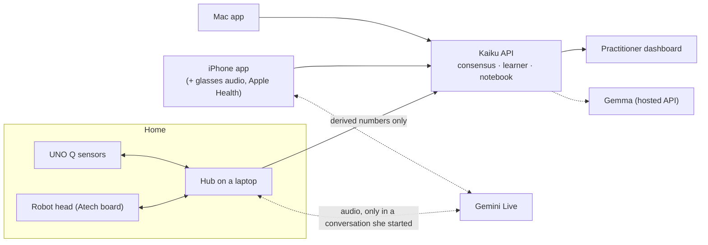

<div align="center">

# Kaiku

*kaiku*: Finnish for "echo"

**A friend on your desk, a voice in your ear, a clearer record for your care team.
Kaiku helps people stay well at home after TMS treatment for depression.**

[](https://hackjunction.app/)
[](docs/tracks.md)
[](pyproject.toml)
[](LICENSE)

**[Run it](#run-it-in-three-commands)** · **[How it works](#how-it-works)** · **[What is real today](#what-is-real-today)** ·
**[Tracks](docs/tracks.md)** · **[Demo narrative](docs/demo-narrative.md)** · **[Submission](docs/submission.md)**

</div>

> [!IMPORTANT]
> Kaiku is a research prototype built in 48 hours. It is **not a medical device** and **not a crisis service**.
> It does not diagnose anything and does not predict relapse. It shows *change from a person's usual* so a
> practitioner can decide to check in. Nothing is validated against patients; the record you see after
> `make demo` is authored and labelled simulated. In Finland: **MIELI Crisis Helpline 09 2525 0111**, emergencies **112**.

<!-- MEDIA: add the public video link (≤ 2:00) and the deployed URL here once they exist. Do not state either before. -->

## Run it in three commands

Needs macOS or Linux and [uv](https://docs.astral.sh/uv/). Optional: Node 20 + pnpm (to build the dashboard pages),
mosquitto (only for the robot and its software twins). No API key is needed to see the dashboard.

```bash
git clone https://github.com/Harrishayy/kaiku.git && cd kaiku
make setup     # Python + web dependencies, creates .env from .env.example
make doctor    # says what is missing and how to fix it
make demo      # broker + local API + dashboard + one person's sixteen-day record; prints the links
```

`make demo` is safe to run twice: it reuses an API or broker that is already up and adds nothing the second
time. It stays in the foreground; Ctrl-C stops what it started. When something is wrong it says what and how to
fix it (port in use, dependencies not installed, dashboard not built). Logs are in `logs/demo/`.

| Then | Command |
|---|---|
| Open the practitioner dashboard | `http://localhost:8000/` (the link `make demo` prints) |
| See today's recordings move the reading | `make live-day` (a good day and a rough day, on a throwaway copy) |
| Start over (record ends yesterday again) | `make demo-reset` (drops simulated data, keeps live recordings) |
| Use another port or database | `KAIKU_DEMO_PORT=8010 KAIKU_DB_PATH=/tmp/kaiku.sqlite make demo` |
| Add the reference cohort (8 synthetic people) | `make seed` |
| Run the robot ritual on software twins | `make sim` and `KAIKU_VOICE=text make hub` in two more terminals |

### The person in the record

Aino, 58, comes home after a TMS course. The record holds her first sixteen days and always ends yesterday, so
today is open for live recordings. Days 1–8 settle her usual. Day 9 is the first late night. Days 10–12 bring
short nights, later mornings, low check-in dials, flat drumming and hardly any time outside. On day 12 the care
team rings and she fills in a PHQ-9. Days 13–16 recover in steps: morning walks with a friend, evening calls with
her sister, the drum ritual. About one capture in ten is missing, as in a real record.

The consensus is not written into the data. The real rule reads it: baseline forming through day 10, the first
signal group worse on day 11 (worth a check-in), several groups from day 12 (needs a call), acknowledged by the
practitioner, and waiting for today. `cloud/tests/test_single_person.py` pins those states day by day.

### Link your own iPhone or Mac to this record

The apps normally create their own home on first run. To add live recordings to Aino's record instead, pair with
the account link that `make demo` prints (`http://<this-mac>:8000/?home=aino`):

```bash
KAIKU_TEAM=<apple team id> apps/apple/scripts/run_on_iphone.sh aino     # build, install, pair the iPhone
# Mac app: launch with  -kaikuPairLink "http://127.0.0.1:8000/?home=aino"
# Robot hub and twins:  KAIKU_HOME_ID=aino make hub
```

A check-in, a game or a walk recorded today is then compared with her sixteen days. Details: [`apps/apple/AGENTS.md`](apps/apple/AGENTS.md).

## The problem

TMS (transcranial magnetic stimulation) helps people with severe depression, and the effect often fades. A course
is about twenty clinic visits, so clinicians see the person almost daily. When the visits end, that view
disappears. Depression also takes away initiative: an app that waits to be opened fails when it is needed.

## How it works

Clinicians never judge from one measurement. Kaiku collects several kinds of everyday signal, compares each with
the person's **own** usual, and combines them with a fixed rule on one practitioner page.

| Signal group | Where it comes from today | What is compared |
|---|---|---|
| **Check-ins & robot** | Mood, energy and sleep dials on the robot's ear or the phone; the robot's ritual | Dials, drum tempo and time, first interaction time, speech pace |
| **Walks & outings** | Walks recorded by the iPhone (voice in the glasses when worn) | Outing minutes and steps |
| **Apps** | Short games on the phone, optional Mac usage rhythm, PHQ-9 | Reaction time, late-night and messaging minutes, PHQ-9 change |
| **Watch** (optional) | Apple Health daily summary | Sleep length and timing, resting heart rate, HRV, steps |

These are signal groups, not independent devices: several can come from one phone, and every record keeps its
real device source. Each group gets a verdict (as usual, better, worse, not enough data).

| State | Rule |
|---|---|
| **Watch / worth a check-in** | One group worse, or too little data to say. A record younger than 21 days is never called stable |
| **Needs a call** | Two or more groups worse; holds until acknowledged or three stable days |
| **Safety** | PHQ-9 item 9 or a crisis phrase: a fixed script and helpline numbers, no model |
| **Stable** | Enough data and nothing worse |

The rule is one readable file, [`config/criteria.toml`](config/criteria.toml), versioned by hash. **No model
decides a person's state or handles a crisis.** Gemma selects evidence for the practitioner review and organises
the companion's notebook; Gemini Live is Kaiku's voice. Code checks every citation and renders every number.

Each suggested activity (a walk, drumming, breathing) is scored right after and the next day, and Kaiku learns
which one helps this person. On a short record that estimate is uncertain and is worded that way.



## What is real today

Kept honest on purpose. The full audit, with evidence, is [`docs/track-readiness.md`](docs/track-readiness.md).

| Part | State |
|---|---|
| Contracts, message bus, software twins of every device | Working, tested |
| API: ingest, baselines, verdicts, consensus, learner, notebook, practitioner insight | Working locally (`make demo`) and deployed on Modal (https://harrish21raj--kaiku-web.us-east.modal.run, public read-only demo with one seeded, simulated 16-day record: add `/?id=aino`; admin routes need a token) |
| Practitioner dashboard | Working, served by the API |
| iPhone and Mac apps: check-in, games, talk, walks, Apple Health | Built and run on real devices; some physical acceptance still open |
| Gemini Live voice, Gemini TTS | Verified with real provider calls; English only |
| Gemma | Verified through Google's hosted API. A scale-to-zero Modal GPU app exists and is unverified |
| Glasses | iPhone integration through Meta's Device Access Toolkit, audio-first, no camera. `apps/glasses-webapp` and `apps/glasses-dat-android` are placeholders |
| Robot head and sensors | Firmware compiles; single-part benches partly run on the boards. The full ritual runs on software twins |
| Robot pulse | Pending the finger cradle: shown as "not measured", never guessed |
| Music from drumming, friend lamp, room light, daylight, iCBT | Not in the demo |

## Commands

```bash
make help            # every target
make demo            # the three-command path above
make check           # lint + all Python tests + web typecheck + generated-file checks
make smoke           # throwaway API + cohort seed + endpoint checks
make criteria        # the consensus rule in effect       make calibrate   # how it behaves on labelled synthetic courses
make cloud-deploy    # deploy API + dashboard to Modal (needs a Modal account)
```

Configuration: `.env` (from `.env.example`, never committed) for keys; [`config/kaiku.toml`](config/kaiku.toml)
for model IDs, timings and ports; [`config/criteria.toml`](config/criteria.toml) for the rule;
[`config/safety_phrases.toml`](config/safety_phrases.toml) for the crisis path. API routes are listed in
[`cloud/AGENTS.md`](cloud/AGENTS.md) and served interactively at `/docs`.

## Repository

```
contracts/   message envelope, payloads, API models, signal-group map (the only shared package)
hub/         robot orchestrator: perception, ritual, safety gate, Gemini Live adapter
cloud/       API: ingest, SQLite, baselines, verdicts, consensus, learner, notebook, Gemma review
apps/        web (practitioner dashboard) · apple (iPhone + Mac) · glasses placeholders
firmware/    Atech head · UNO Q sensors
sim/ tools/  software twins, seeders, bus tools, doctor, evals
config/      criteria, settings, persona, voice lines, safety phrases
demo/ docs/  demo notes · plans, decisions, progress log, safety, privacy, tracks
```

New here? Read [`AGENTS.md`](AGENTS.md), then the `AGENTS.md` of the module you will touch.

## Safety and privacy

- **Fixed crisis path.** PHQ-9 item 9 or a crisis phrase stops everything and shows a pre-written message with
  the helpline numbers; the dashboard shows a safety state. It does not call anyone. See [`docs/safety.md`](docs/safety.md).
- **Derived numbers only.** The API rejects anything that is not an observation. Camera frames are processed in
  memory. Audio goes to Gemini Live only during a conversation the person started. See [`docs/privacy.md`](docs/privacy.md).
- **The person decides.** Every signal is opt-in; notebook entries and kept conversations can be deleted; the
  care team never sees them. Sharing what Kaiku learned (activities and routines only) is off by default.
- **Care actions are records.** They are saved in Kaiku; they do not contact anyone.

## Limits

- Not clinically validated. Only PHQ-9 is a validated instrument; the games are not.
- Thresholds are engineering defaults, tested on simulated courses ([`docs/validation.md`](docs/validation.md)), never on patients.
- A new record cannot be compared before about day 9, and a first flag needs three of five days: day 11 at the earliest.
- A partial day (steps or screen minutes so far) can read lower than a full one.

## Team and licence

Built at **Junction 2026**, Espoo, 13–15 November 2026, by Harrish Ayyanar and team. Thanks to the Aalto
University researchers in Prof. Risto Ilmoniemi's and Prof. Pantelis Lioumis' group and to the challenge mentors.

[MIT](LICENSE); all code was written during the event. Third-party services, models and hardware keep their own
terms ([Gemini API](https://ai.google.dev/gemini-api/terms), [Gemma](https://ai.google.dev/gemma/terms), Modal,
the Meta Wearables platform, Atech). CAD sources and licences: [`hardware/`](hardware/AGENTS.md).
