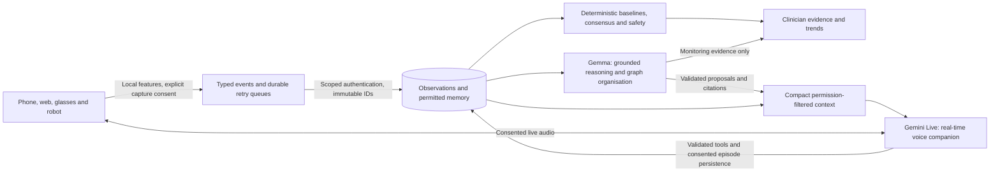

# Decisions (ADR-style)

Format: `## D<n> — <title> (<date>, <who>)` · Decision · Why · Alternatives. Open questions D1–D9 and
their defaults are in docs/plans/01-foundation.md §12 — record the actual answer here when it's made.

## D10 — Pydantic models are the contract source of truth (2026-11-13)
- Decision: author contracts in `contracts/python/kaiku_contracts/` (pydantic v2); generate JSON Schema +
  TS with `make contracts`; a test fails when generated files are stale.
- Why: one place to edit, impossible for schema and code to drift; still gives non-Python modules schemas.
- Alternatives: hand-written JSON Schema + datamodel-codegen (two steps, drift-prone).

## D11 — Fully-qualified message `type` decides the topic (2026-11-13)
- Decision: `type` is `obs.<name>`, `raw.<source>.<stream>`, `cmd.<target>`, `health`, `log`.
- Why: unambiguous validation without the topic, and sims can publish `raw/head/*` while flagged `sim: true`.

## D12 — Shared kit lives in kaiku_contracts (2026-11-13)
- Decision: `Bus` (MQTT), config loader and JSON logging live in `kaiku_contracts`, the one package all
  modules may import. `sim/` and `tools/` are dev harnesses and may import modules.

## D13 — Web apps use Next.js static export (2026-11-13, team request)
- Decision: `apps/web` (and the glasses web app) are Next.js App Router + TS with `output: 'export'`,
  served as static files by the Modal FastAPI app (single public URL; Modal stays central for judging).
- Consequences: no server components fetching at request time, no API routes, dynamic pages via query
  params (`/clinician/patient/?id=aino`).

## D14 — Mosquitto broker on the hub laptop, anonymous on the demo LAN (2026-11-13)
- Decision: `config/mosquitto.conf` allows anonymous on :1883; switch to a password file for the demo
  hotspot if anyone else can join it.

## D15 — Glasses source turns "worse" on one drifting metric (2026-11-13)
- Decision: `[consensus.sources.glasses] worse_min_metrics = 1` (robot 2, laptop 1).
- Why: the glasses only measure outing minutes (+ steps), which are strongly correlated; requiring 2 would mean
  the glasses could never vote "worse". Tune with the simulation; change = new `rule_version`.

## D16 — Browser apps authenticate with a pairing link (2026-11-13)
- Decision: when `KAIKU_HOME_TOKEN` is set, every `POST /v1/events` needs `Authorization: Bearer <token>`. The
  laptop/glasses apps get it once via `?home=<id>&t=<token>` and keep it in localStorage. No Gemini or admin key
  ever reaches a browser.
- Alternatives: unauthenticated browser sources (v1 demo shortcut, removed); per-device OAuth (no time).

## D17 — v2: three-source consensus, name stays Kaiku (2026-11-13)
- Decision: adopt the v2 plan (robot, glasses, laptop → per-source verdicts → deterministic consensus v1 with
  states stable / watch / needs_call / safety) but keep the name Kaiku everywhere (packages, topics, env, docs).
- Contract changes: `obs.self_report` replaces `obs.mood_dial`; `obs.phq9` replaces `obs.checkin`; new
  `obs.laptop_session`, `obs.intervention_response`; `obs.outing`/`obs.nudge_outcome`/`obs.speech_features`
  reshaped; envelope source `laptop` replaces `checkin`; `cmd.hub.phq9_due`; API status → consensus. Still `v: 1`
  (nothing was deployed or stored yet).

## D18 — Module registry + per-module AGENTS.md as agent ground truth (2026-11-13)
- Decision: `modules.toml` lists every module and its message flows; every module folder carries
  `AGENTS.md` (+ `CLAUDE.md`, `GEMINI.md` pointers); `tools/agents_sync.py` enforces it in `make test`.
- Why: any agent (Claude Code, Codex, Gemini CLI, Cursor) gets the same module context on entry, and drift
  between code and docs fails the build instead of silently confusing the next agent.

## D19 — Consensus criteria are data, not code (2026-11-13, team request)
- Decision: every parameter that decides how a data input is used (metric definition, filter, daily aggregation,
  worse direction, weight, enabled, per-metric thresholds; source vote settings; state combination; direct rules
  such as PHQ-9) lives in `config/criteria.toml`, validated by `kaiku_contracts/criteria.py`. Rule version =
  `<name>+<hash>`, so every tuning is traceable. Live override + preview on the cloud (`/tune/`), offline
  comparison with `make tune`.
- Why: the criteria will change constantly during the hackathon; tuning must not need code changes or deploys,
  and a bad edit must fail validation with a readable message instead of silently changing behaviour.

## D20 — First criteria tuning pass (2026-11-13, simulation, 40 synthetic patients)
- Change: glasses `outing_min`/`steps` `missing = "skip"` (was "zero"); robot `worse_min_weight = 2.5` (was 2.0).
- Why: counting walk-free days as 0 minutes made the glasses source "worse" on ordinary quiet days (most false alarms).
- Current numbers (`make tune`, `consensus-v1+4936eb40`, cohort incl. a glasses+laptop-only drift scenario):
  needs_call precision 1.00, recall 0.76, false needs_call 0.00 per patient-month, **median lead time 2.0 days**.
- The open trade-off (same cohort) — pick consciously, re-run `make tune` after changing:

  | variant | needs_call precision | recall | false / patient-month | lead (days) |
  |---|---|---|---|---|
  | robot 2.5 (current) | 1.00 | 0.76 | 0.00 | 2.0 |
  | robot 2.0 | 0.90 | 0.76 | 0.06 | 2.0 |
  | robot 2.0 + z 1.75 | 0.98 | 0.61 | 0.03 | 3.5 |
  | robot 2.5 + drift 2 of 4 days | 0.69 | 0.88 | 0.25 | 4.5 |

  Earlier calls cost false alarms; the clinical story ("caught early, a booster can rescue it") argues for lead
  time, the "no extra clinician workload" story for precision. Decide with mentors (Phase 4).
- Caveat: synthetic patients from our own generator — this tunes the rule against our assumptions, not real
  people. Re-tune once tester data exists; record each pass as a new D-entry.

## D21 — One context file: AGENTS.md (2026-11-13, team request; supersedes the pointer files in D18)
- Decision: each module has exactly one doc, `AGENTS.md` (module README content folded in, one section per fact).
  No `CLAUDE.md`, `GEMINI.md` or module `README.md` anywhere; the root `README.md` stays as the public project page.
- How each tool finds it: Claude Code ≥ 2.1.281 reads `AGENTS.md` natively (root at start, nested when it opens
  files in that folder) — but only when no `CLAUDE.md` exists, so a `CLAUDE.md` would actively break it. Gemini CLI:
  `.gemini/settings.json` `context.fileName = ["AGENTS.md"]`. Codex reads root → launch directory (open the module's
  `AGENTS.md` when launched at the root). Cursor: reads `AGENTS.md`; nested loading unverified.
- Enforced by `tools/agents_sync.py` in `make test`.

## D22 — One companion character, Kaiku, on every surface (2026-11-14, team request)
- The mascot is the robot's own face (eyes, single ear, chest glow), drawn from one spec in `design/`. Transient
  states are local to each interaction; the ambient mood comes from the cloud as a pure function of state and
  never looks sad or worried at the person. Details: `docs/plans/02-companion-apps.md` §2.

## D23 — Design direction: warm, simple, quiet (2026-11-14)
- Cream / ink-brown / clay accent / sage / sky, rounded type, no red outside the crisis screen, Reduce Motion respected.
  Tokens live in `design/tokens.json`; CSS and Swift are generated from it.

## D24 — Native SwiftUI multiplatform app for iPhone + Mac; cloud SQLite stays the one database (2026-11-14)
- Why native, not a web wrapper: the Meta DAT SDK (glasses camera/mic/IMU/speech), HealthKit (watch data),
  ActivityKit (Dynamic Island) and macOS frontmost-app sensing are native-only. One XcodeGen project with a
  shared `KaikuKit` package keeps iPhone and Mac identical. Sync = every device pairs to the same `home_id`.

## D25 — Fourth, optional consensus source `wearable` (2026-11-14)
- HealthKit daily summary (sleep, resting HR, HRV, steps) from Apple Watch or any watch writing to Apple Health.
  Optional: a missing source is "insufficient" and simply not counted, so people without a watch lose nothing.

## D26 — Laptop usage rhythm, not content (2026-11-14, supersedes the "track content consumed" idea)
- The Mac app records minutes by broad category from the frontmost app's bundle id, late-night minutes, switches,
  stretches and breaks. No titles, URLs, keystrokes or screenshots; opt-in per signal, pausable, shown in "What
  Kaiku saw today". Written fresh at the event; no code from any earlier personal project (hackathon rule 10).

## D27 — Unified voice and script (2026-11-14)
- One Gemini prebuilt voice (`config/kaiku.toml [voice]`) and one keyed script (`config/voice_lines.toml`) for robot,
  apps and glasses; cloud `GET /v1/voice/{line_key}` serves cached audio. Crisis text stays scripted.

## D28 — Plans live in `docs/plans/NN-*.md` (2026-11-14)
- `handoff.md` became `docs/plans/01-foundation.md` (✅ DONE, kept as reference). New plans get the next number;
  done plans are marked, never rewritten. The "Hexarp" draft was dropped; the name is Kaiku.

## D29 — Plan-02 signals in the criteria, conservative; second tuning pass (2026-11-14, workstream B, simulation)
- Change: `[sources.wearable]` (expected 7/week, `worse_min_weight = 1.0`: two half-weight watch signals must drift
  together) and 11 new metrics, **all `weight = 0.5`**: wearable `watch_sleep`↓, `sleep_midpoint`↑ (later),
  `resting_hr`↑, `hrv_sdnn`↓, `daily_steps`↓; apps `late_night`↑, `active_min`↓, `communication_min`↓
  (`category_min.communication`, nested fields now supported), `firefly_reaction`↑; glasses `cadence`↓,
  `daylight_min`↓. Optional `person_hard` sentences drive the gentle "hard day" notes on `/me`.
- Cohort: 13 scenarios (adds robot+watch drift, watch-only drift, stable without a watch); demo Aino now drifts on
  robot + apps + watch, with a sub-threshold glasses cadence dip (glasses stay "as usual" → disagree).
- Numbers (`make tune`, 40 synthetic patients):

  | metric | D20 `consensus-v1+4936eb40` (3 sources) | D29 `consensus-v1+6763c8eb` (4 sources) |
  |---|---|---|
  | needs_call precision / recall | 1.00 / 0.76 | 0.97 / 0.90 |
  | false needs_call per patient-month | 0.00 | 0.03 |
  | median lead time (days) | 2.0 | 6.0 |
  | stable precision / recall | 1.00 / 0.98 | 0.97 / 0.98 |
  | watch precision / recall | 0.80 / 1.00 | 0.89 / 0.90 |
  | ablation needs_call recall without robot / glasses / laptop / wearable | 0.33 / 0.33 / 0.33 / — | 0.17 / 0.50 / 0.50 / 0.67 |

- Reading: a fourth independent source buys recall and lead time (+4 days) at a small false-alarm cost (0.03 per
  patient-month). People without a watch lose nothing (scenario "stable, no watch" stays stable). Weights stay at
  0.5 until tester data exists; raise them one at a time with `make tune`.
- Caveat as D20: our own generator, not clinical validity. The rule version above is the file at this commit.

## D30 — Robot body: "cathedral radio", 2 motors, vision-only presence (2026-11-14, Edwin)
- Decision: the head is built around the Arduino USB Camera (ring light = round grille, Color Display above =
  eyes in a tuning window, Knob = left ear). Two Atech DC motors: **pan** (12:40 gear) and **purr** (eccentric
  weight), as in `docs/plans/01-foundation.md` §8. **No tilt** (a 200 g head that sits in front of the motor would make it slip back under
  load) and **no arms**. KY-050/051 dropped: presence comes from vision.
- Why: fewer motors means less current and fewer Atech ports. The 12-port budget is display 2, knob 2, IMU 1,
  LED ×2, button 1, motors 2, plus Microphone *or* Speaker (`hardware/assembly.md`).
- Print budget: MVP (head + neck, cardboard body) about 3 h 20 min. Full printed robot about 5 h 50 min on a P1S
  or P2S (`hardware/cad/README.md`).

## D31 — Electronics spec merged into the printed design (2026-11-14, Edwin; supersedes the motor count in D30; `D23` on `main`)
- Context: `docs/kaiku_robot_electronics_specs.md` (Xavier) arrived after the CAD was printing. Where they
  disagreed, the physical design won. The spec's additions that need no reprint were adopted: the Modulino Buzzer
  (body), the KY-031 knock sensor (under the head top, on the UNO Q) and a powered USB-C PD hub (outside, behind the
  robot).
- Atech ports: Speaker 1–2, Display 3–4, Knob 5–6, pan motor 7, Mic 9–10, Button 11, LED grids 13 and 14. All
  12 are used, so there is **one motor** (pan) and **no Atech IMU** (the KY-031 handles taps). The purr mount stays
  in the CAD as an option if a port frees up.
- Open at the time, settled in D32: hub location; `firmware/atech-head/AGENTS.md`; the spec's MQTT topics.

## D32 — Robot electronics in software: the spec on our contracts (2026-11-14, team; builds on D31)
- Decision: build `docs/kaiku_robot_electronics_specs.md` as reconciled in D31, mapped onto the existing contracts
  (`docs/plans/07-robot-electronics.md` §1). The Atech board does the eyes (Color Display), the Knob dial
  (`raw.head.ear`, unchanged), the lid button, the chest LED grids (`chest`/`bpm`/`color`, unchanged), the pan motor
  (open loop, homed on the KY-035 hall edge, which it receives as `raw.sensors.hall`) and the speaker purr tone. The UNO Q
  does the KY-031 knock, KY-035 hall, KY-054 light, KY-039 via KY-053, buzzer chimes and the camera (faces, distance
  from face size, backup room light, **camera pulse as KY-039 backup**).
- **Hub + broker stay on the laptop** (D14 and plan 01 §5; the spec proposed the UNO Q). Everything is MQTT, so
  moving them later is a config change (plan 07 §4). **Voice stays on the laptop in v1.** PCM through the Atech
  speaker/mic is STRETCH, on separate `audio/` topics that are never recorded or uplinked. The Speaker stays fitted
  for that.
- **One button rule:** a long press ≥ 2 s stays the manual safety trigger. A short press when idle starts a ritual.
  The spec's 800 ms long press isn't used. An optional press-count dial (`[robot] dial_input = "button"`) stays as
  a fallback in case the Knob is out.
- The camera turns with the head (`[attention] camera_on_head`): pan targets are relative to `raw.head.pan`.
- Keep the module name `unoq-sensors` and source `sensors`. Plan number 07 (06 is the Gemini-first mind).
- Contract changes, all additive (`SCHEMA_VERSION` 1): `raw.head.button`, `cmd.head.gesture`
  (`look_left|look_right|shake`; the head only pans), `cmd.sensors.chime`, and optional `raw.head.tap.force` /
  `obs.drum_session.force_mean` (a knock switch has no force: `None`, never invented).
- Every part has a bench test that runs alone (`make bench PART=...`), and integration starts only after they pass.
- Why: the hub, sims and cloud keep working unchanged; the new hardware is adapters at the edges.

## D33 — Opt-in conversation transcripts for teaching Gemma (2026-11-14, lead)
- Decision: the lead wants Kaiku's own Gemma to learn from real conversations. Transcripts are stored **only with
  the person's opt-in** (`transcripts` signal, off by default, explained in onboarding and What Kaiku remembers),
  person-facing and deletable, never on a clinician route, never logged. A conversation that ends in a crisis or
  contains a crisis phrase is never stored. Training uses a de-identified export (`kaiku_cloud.jobs.transcripts_export`):
  the person's name, people and places from their own notebook, emails, phone numbers and URLs are replaced; the home
  id is hashed. Simulated-persona runs against real Gemini Live (`apps/apple/scripts/live_e2e.sh`) feed the same set.
- Why opt-in, not everyone: these are people recovering from depression; storing every word by default would break
  the consent design (docs/privacy.md) and plan 06 §6 ("needs team OK"). Changes the apple and cloud invariants
  that said "no transcript is stored".
- Not yet: the robot hub, glasses web app and web /me don't send transcripts (only the Apple apps do); the person can
  delete all but not yet read each conversation in the app (the API returns them).

## D34 — Dashboard: the week and "What Kaiku has learned", shared with the care team only by the person's choice (2026-11-14)
- Decision: one deterministic summary (`cloud/kaiku_cloud/week.py`) gives both audiences the same facts: **routines**
  (from observations; for the person also from conversations), **going well** and **worth a look** (routines kept or
  slipped, per-metric drift from `config/criteria.toml`, verdicts, the bandit, safety flags, PHQ-9 cadence), and the
  **knowledge graph** with evidence counts. Person wording is warm and never shows states, scores or z values;
  the care team sees the numbers. No model decides or phrases any of it; it never changes the consensus.
- Privacy: the graph was person-only (plan 06). The care team now sees it **only when the person turns on "Share
  with my care team"** on `/me` (`PUT /v1/me/sharing`, default **off**), and then only activities, what helps and
  routines. People, places, likes and plans are withheld by design (listed as `withheld`), and the memories list,
  episodes and transcripts are never shown. Turning sharing off hides it at once (nothing is copied).
- Why: practitioners asked to see what is going right and wrong and what helps, and the person asked that their
  care team see it. Default off follows `docs/privacy.md` ("never shown to clinicians") until the person opts in.
  The demo seed turns it on for Aino only (her choice in the story); `sim-eero` shows the "Not shared" card.
- Thresholds: `config/kaiku.toml [week]`.

## D35 — Gemma organises the shared record; Gemini Live carries the conversation (2026-11-14)
- Decision: Gemini Live consumes a compact, permission-filtered context card and confirmed tool results for
  immediate voice interaction. It calls `ask_mind` when information is missing, conflicting or requires deeper
  reasoning. Gemma is the primary model behind that tool and the batch graph-consolidation job. Do not put a
  second model call in front of every greeting, known fact or activity acknowledgement.
- Graph structure starts with recorded, consented facts and deterministic links. Gemma proposes bounded
  merge/expiry changes; code validates ownership, identifiers and admissible changes before applying them.
  Raw observations remain unchanged. The monitoring consensus and crisis path remain deterministic.
- Input provenance means the actual envelope source/channel, time and simulation flag, not merely a consensus
  group. A phone walk can contribute to the walking signal without establishing a Meta connection. The
  context compiler exposes permitted activities, never clinician scores or private transcript contents.
- Efficiency: no model inference per sensor sample; no model inference to assemble a session card. Reuse the
  prepared record, send bounded new-activity context during an active session, consolidate changed graphs in
  batches, and cache explanations by their semantic evidence. Session duration and estimated spending stay
  bounded. Cached Gemini TTS supplies fixed voice lines; OS dictation/synthesis is not a voice fallback.
- Deployment truth: the verified Gemma path is hosted Gemma through the Gemini API. The self-hosted Modal
  adapter exists but is not evidence that the demo's calls stayed on a private GPU. The Gemma challenge permits
  hosted access; private deployment or fine-tuning must only be claimed after its own validation.
- This supersedes the Gemini-first reasoning preference in plan 06, and narrows “Gemma only explains” to the
  monitoring verdict: Gemma also organises permitted companion knowledge, but never decides a health state.

- Runtime distinction: the development API serves the existing LAN database. The Modal API configuration
  retains one warm CPU container and one SQLite writer when deployed. The separate optional Gemma GPU app
  scales to zero; it is not on the verified hosted-Gemma request path. Keeping an H100 continuously warm
  would incur idle GPU cost and is not needed for the hosted path. Neither a local server nor a declared
  Modal configuration proves that a public API is deployed.
- Browser device capture requires HTTPS or localhost. A plain HTTP LAN address serves the clinician page
  and camera-free activities, but browsers cannot capture camera/microphone there. Native iPhone capture
  is governed by iOS permissions separately. Each screen checks the actual capability before offering capture.

## D36 — Honest delivery, freshness and corrected daily summaries (2026-11-14)
- Person and clinician data require separate scoped credentials; explicit local demo mode is the exception.
  A command remains queued until the robot acknowledges successful application. A stored safety flag is not
  a promise that somebody has read it or will contact the person. The fixed crisis script no longer makes
  that unverified promise; the safety guidance itself is unchanged.
- Phone/web ad-hoc mood, energy and sleep check-ins count alongside ritual check-ins. Activity before/after
  ratings remain separate. Sources stop voting when older than their configured `max_age_days`.
- Health daily summaries use their target payload date, ordered by actual capture timestamp; a revised
  snapshot gets a new immutable event ID and the latest capture wins. Offline older snapshots cannot replace
  newer summaries. See `config/criteria.toml` for the exact settings.

## D37 — Optional task capture records observable measurements, not emotions (2026-11-14)
- Reaction timing comes from the task itself. Spoken tasks measure pace, pauses and pitch only when the
  microphone is explicitly enabled. Optional camera capture starts with the task, stops on cancellation or
  backgrounding, and sends only local aggregate features with method, usable-face coverage and sample count.
- Web MediaPipe blendshape variability and iPhone Vision landmark variability are different methods. They
  must not share a baseline or be presented as equivalent emotional measurements. Low or absent face coverage
  is missing evidence; it must not become a zero expressivity score. Movement can also reflect camera motion.
- The clinician task inspector exposes provenance and participation. No new facial-feature consensus metric
  is enabled. Record chat receives capture coverage, not facial indices or inferred emotional labels. There is
  no per-frame Gemini call, raw-media upload or background ambient recording in this task-capture path.
- Companion evaluation exposed an ordinary hard-day response that offered a care-team hand-off before a small
  activity. The shared persona now offers one optional activity first, requires agreement before launching it,
  and reserves medical hand-offs for relevant requests. It does not offer message delivery that has no tool.

## D38 — Phone/glasses voice is independent of robot setup (2026-11-14, lead)
- A phone conversation needs the companion API and Gemini Live, not a paired robot. Meta registration identifies
  the glasses; Bluetooth routes the phone's microphone/speaker session. Neither connection provisions a person's
  backend profile. These states must be shown separately, with the actual audio route visible during Talk.
- QR-first setup is replaced by companion-service discovery. The API advertises `_kaiku-api._tcp`, distinct from
  robot hardware, and exposes a public identity/capability descriptor. It contains no home IDs or credentials.
  The local harness starts its announcement only after readiness and removes it when the server exits.
- Only the configured demo service may bootstrap automatically. Other nearby candidates require selection.
  Fresh local profiles have stable per-service installation IDs; previously saved profiles remain intact.
  Discovery never forwards another service's credentials or grants access to an existing person's record.
  Authenticated deployments still require scoped provisioning; an unconfigured server stays closed.
- Robot, phone and glasses retain separate device capabilities and surface-specific tools. Shared memory does
  not permit a phone to claim robot sensors or actions. Physical robot acceptance is deferred at the lead's request.

## D39 — Robot sensors after the first bench run: no KY-054, no KY-035 (2026-11-14, Edwin)
- **No KY-054 light sensor:** room light comes from the camera (`[unoq] light_source = "camera"`, exposure locked,
  ring light off). The camera bench passed on the board (`/dev/video2`, so `camera_index = 2`).
- **No KY-035 hall sensor** (no magnet available): home = the head's position at power-on (face it forward before
  powering up). `HAS_HALL 0` in both firmwares: the Atech `home` drives back to the dead-reckoned 0°, soft limit ±80°
  (from ±100°); the UNO Q never polls the floating A1. Face tracking is relative (camera in the head), so drift
  doesn't affect looking at the person. The CAD keeps the magnet pocket and the sensor spot: with a 6×3 mm magnet and
  a KY-035, set `HAS_HALL 1` and nothing else changes.
- **KY-039 + KY-053 kept**, pending a retest in the printed finger cradle: the electronics pass, but in open room light
  no heartbeat was found (the Garmin read 44 bpm; the sensor showed only a ~117 bpm light-flicker artefact). If the
  cradle doesn't fix it, HR/HRV is "not measured" (or the camera backup), never guessed. The bench now requires a
  steady 30–220 bpm beat, so noise can't pass again.

- Integration note: upstream used D35; retained here as D39 because D35 already names the shared Gemma/Gemini decision.

## D40 — Use the supported capture profile, not the sensor wish list (2026-11-14)
- The present hub profile disables light observations/context, even though the camera bench can estimate
  luminance. Unvalidated robot pulse, knock force, retired browser metrics and unavailable glasses camera/IMU
  features do not appear as measured default records or enabled scoring inputs. Historical contracts stay readable.
- Optional Apple Health measurements remain distinct from robot pulse. A phone's steps and outing duration do
  not establish outdoor location, measured daylight or a physical Meta connection. First interaction is not a
  claim about waking up. Default simulations and reference histories follow these limits.
- Suggestions are restricted to implemented configured activities. An old reward row cannot re-enable an
  unavailable action. English is the current companion/UI language; crisis matching retains its existing coverage.

## D41 — Preserve received transcript words and represent unknown finality (2026-11-14)
- Provider audio completion and per-speaker transcription completion are separate events. Ordered native event
  consumption keeps late ASR attached to its original bubble; new speech/model generations separate legacy
  marker-free turns. Typed text cannot steal an outstanding spoken turn.
- Optional `TranscriptTurn.complete` is true only for an explicit final marker, false for known interruption or
  truncation, and null for unknown legacy/provider completion. No absent marker is promoted to a final guarantee.
  The real configured-provider probe returned audio/text but no explicit final markers. This remains an acceptance
  limitation; the UI does not misleadingly label every ordinary unknown turn incomplete.

## D42 — Early collection needs useful evidence, not a premature usual (2026-11-14)
- A short record can show emerging repeated activities before the full usual-period window exists. Routine
  attendance uses the actual collection horizon, still requires the configured minimum occurrences, and says
  emerging rather than inventing missing historical weeks. Baseline/consensus thresholds remain unchanged.
- First/latest seven-day comparisons retain dates, measured-day counts and units. Co-occurring changes across
  mood, energy and outings are an observed association, not proof that an activity caused an improvement.
- Gemma selects supported evidence for the practitioner review; code renders numeric facts and direction.
  The visible routine graph contains permitted activity/routine edges only. Private people, memories, episodes
  and transcripts do not become clinician-visible because the person opted into the shared activity graph.

## D43 — Glasses camera frames may go to Gemini Live, and nowhere else (2026-11-14)
- The lead asked for active vision on walks and agreed to adjust the rule. The Meta Device Access Toolkit (iOS,
  MWDAT 1.0.1) gives a registered app a camera stream from Ray-Ban Meta glasses (`DeviceSession.addCamera` →
  `camera.stream`, 360 × 640 at 2 fps is the lowest setting) after a camera permission granted in the Meta AI app.
- Rule 5 now has one exception: with the separate opt-in "Let Kaiku see through the glasses during walks" (off by
  default, reversible mid-walk, with a visible indicator and Pause), about one JPEG frame a second goes from the
  iPhone directly to the walk's open Gemini Live conversation (`realtimeInput.video`). Nothing is sent when the
  conversation is muted, paused, closed, re-paired, or everything is paused.
- Frames are never stored, logged, queued, or sent to the Kaiku cloud. No observation is derived from them:
  `daylight_min` stays unfilled and disabled, because auto-exposed frame brightness is not a light measurement.
  Provider-side Live retention is the same as for audio (privacy.md).
- Verified: frame gating (unit test), the toolkit stream path with Mock Device Kit in the simulator, and one real
  Gemini Live call where a generated picture of a sign plus an injected spoken question produced an answer naming
  the word on the sign. Not yet verified: real glasses frames, Wi-Fi/Bluetooth transport on the lead's phone, quality
  outdoors. Raw frames arrive only while the app is in the foreground; with the phone locked the voice continues
  and seeing pauses.

## D44 — Atech head runs the standalone ritual firmware for now; the MQTT firmware is the next stage (2026-11-14, Edwin)
- **Active:** `firmware/atech-head/standalone/` (written with the Atech website agent): the head runs the check-in
  ritual itself (greet, mood/energy/sleep dial, breathing, drumming) and talks JSON lines over USB serial. No Wi-Fi,
  MQTT, contracts or hub watchdog, so the hub, UNO Q and cloud don't see the head while it runs. Its layout: speaker
  1-2, display 3-4, knob 5-6, LED grid 7, mic 9-10, motor 14 (was 11, which only turned one way), orientation sensor (ICM-40608/LSM6DSOX) 13; no button.
  Its `src/` stays as the website agent wrote it (one edit: the drum clock starts at the first tap), so a new
  version drops straight in (re-apply that edit). `make atech-standalone FLASH=1`.
- **Next stage:** the MQTT/contract firmware (`firmware/atech-head/`, `kaiku_link/`) is kept intact and still builds;
  going back is `make atech-mqtt FLASH=1`. Porting the standalone's good parts (ritual feel, eye shapes, purr nudge,
  orientation-sensor taps) into `kaiku_link` happens then, behind the contracts (the hub keeps the ritual, D32).
- **Why:** it works on the board today and gives a demo-able head while the motor and power questions are settled.
- **Power (bench):** the motor only turned once the Atech had its own USB-C charger on port 8; hub charge-only and
  Mac ports ran the logic but not the motor. Port 11's forward line is GPIO44 (UART0 RX) and only reverse turned
  there; port 13 has no such conflict, but the standalone puts its orientation sensor on 13.

## D45 — Walk styles, nudges answered with silence, activity cards, call length and the daily invitation (2026-11-14, lead)
- **Three walk styles** (`CompanionSessionRequest.walk_style`: `quiet | playful | chatty`, default in
  `config/kaiku.toml [walk]`): quiet is the walk as it was; playful runs one small game at a time; chatty keeps a
  gentle conversation going. What each is: `config/persona.md` "Walking together". Word limits and rules per style:
  `config/surfaces.toml [surface.glasses.styles.*]`. In every style a feeling ends the game (`feel`).
- **The walk's own clock** (`CompanionSessionResponse.walk`: `look_every_s`, `look_prompt`, `quiet_after_s`,
  `quiet_prompt`, all from `[walk.<style>]`): the device sends the prompt as a context line; the model may leave it
  unanswered. Real Gemini Live sessions with stock macOS pictures as frames (2026-11-14): with
  `proactivity.proactiveAudio` the remarks were timely and grounded (a sunset got one remark, a lone tree got "Is
  that your favourite tree up there?", a dull road got no words), but 9 of 14 declined nudges still carried 0.7 to
  2.8 s of audible non-speech sound. **Rejected:** a `stay_quiet` tool (NON_BLOCKING + SILENT): silence was exact,
  but in 5 of 5 runs the remark arrived one or two looks late, about a picture already gone. **Chosen:** proactive
  audio in `live_setup.proactivity`, and the device plays a nudge's reply only once its first output-transcription
  fragment contains a real word.
- **What it may connect to:** on a walk the card carries `outdoor_likes` (notebook places, and likes that name
  something a walk can pass). Kaiku says a connection as a question ("Is that your cherry tree?"), because it cannot
  know it is that one. A favourite pointed out on a walk is kept with `remember` in the person's own words. D43
  stands unchanged: frames go only to the Live conversation, nothing is stored or derived from them.
- **Spotting games by tool:** `set_walk_goal {thing, target 1..5}` and `log_walk_moment`; the device keeps the
  count and answers `{thing, target, found, left}`. The fixed light hunt is one such goal.
- **Activity cards by tool:** `suggest_activity {kind, line?}` on the phone and Mac puts one card in the
  conversation; it opens nothing. A card put aside is a no for the whole conversation. `Activity` is the list of
  screens that exist: breathe, tell, walk, lantern, seeds, watering, pebbles, firefly, drum, light_hunt.
- **A talk is like a call:** a Talk on the phone or Mac and any walk may run 30 minutes (`[live].talk_max_minutes`,
  `walk_max_minutes`); a check-in, a break and the robot ritual keep 5. One ephemeral token and its budget
  reservation cover `[live].token_minutes` (5); a longer call asks for the next one (`resume_session_id`). Gemini
  resets a Live connection after about 10 minutes and, without context window compression, ends an audio session at
  15 minutes and one with camera frames at 2 (Live session-management guide); `live_setup` therefore carries
  `sessionResumption` and `contextWindowCompression.slidingWindow`. `idle_end_s` (180 s, 900 s on a walk) tells the
  device when to close a conversation nobody is speaking in.
- **The invitation** (`GET /v1/me/invitation`): at most one thing a day that Kaiku would like to bring up or offer,
  chosen by code: first something the person left open (in their own stored words), else the suggestion with the
  best recorded response or a game they come back to. No offer on an extra-gentle day; a not-now is final for that
  item, and an item that was answered is not offered again. The sentence is a template in `config/voice_lines.toml` (`invite.*`). No model call.

## D46 — A Live budget reservation settles to the time the conversation really ran (2026-11-14, lead)
- **Why:** a mint reserves the token's whole lifetime ($0.60 for five minutes) because the cloud never sees the
  audio socket. Nothing ever gave the unused part back, so a day of short test talks held most of the cap.
- **Rule:** the reservation row stays as it is; `live_settlement` rows are appended that name it and bring it to
  whole started minutes, at least one, at most what was reserved. A later signal that shows a longer conversation
  takes some back; a shorter one changes nothing. A conversation that never reports keeps its full reservation, and
  so does a mint that failed. The caps read the plain sum of all rows.
- **Signals, all of them the cloud's own or our own app's:** the `end_session` tool and a crisis stop (now, plus
  `[live].settle_grace_s`), the next mint of the same conversation, `POST /v1/companion/close {home_id, session_id,
  elapsed_s}`, and a recorded episode's own start and end. No reported length ends a conversation before the last
  tool call the cloud saw.
- **Not a billing system:** our app reports its own length; this is the safety brake's arithmetic, bounded by the
  token's lifetime, which Gemini enforces.
- **Old rows:** `python -m kaiku_cloud.jobs.settle_live --ledger <file> --db <cloud db> ...` (dry run unless
  `--apply`) settles a reservation only where a database that provably charged that ledger recorded the
  conversation and its end.

## D47 — A spotting game is set before it is counted; one frame answers one frame of tool calls (2026-11-14)
- **What happened:** on a real Live walk Kaiku proposed "three birds", the person answered "Found one!", and it
  counted aloud by itself ("That's one!", "Two found so far.") without ever calling `set_walk_goal`. The goal card
  never appeared and the spoken count had no source.
- **Rule:** the order is spelled out in the walk prompt ("This walk"), in the persona's playful paragraph and in
  both tool descriptions: a proposal sets nothing; the moment the game is taken up (a yes, or simply a first find)
  `set_walk_goal`, then `log_walk_moment` once per find, and a count is said only as a tool result gave it. The
  device answers a find without a goal with a `note` saying so (`WalkMomentResult.note`).
- **Measured on the real Live model** (typed lines, six short sessions): the goal was set first every time. When
  two calls arrived in one server frame and were answered in two frames, the model issued `log_walk_moment` again
  and the device count ran one ahead of what was said (3 of 3 sessions); answered together in one `toolResponse`
  frame, tools and spoken counts agreed (3 of 3). Devices answer every call of one `toolCall` frame in one frame.
- **Reset:** a demo reset that wipes a home also removes its `episode-thread:` markers and `invite:` state.
  Without that, a re-seed of the same days (same episode ids) never re-opened the seeded threads, and the seeded
  person had no invitation.

## D48 — The person may see their own numbers in one place: History (2026-11-14, lead)
- **Rule so far:** the person-facing apps never show scores, trends or state words (D34: "never shows states,
  scores or z values"). That rule stays for every other screen and for everything Kaiku says.
- **Decision (lead):** one person-facing place shows numbers, the way a health app does: `GET /v1/me/history`
  (`PersonHistory`, `cloud/kaiku_cloud/history.py`). It is the person's own record by day and by session, from
  every device: robot (drum tempo, taps, steadiness, time; ritual steps; first hello; speaking pace; heart rate
  and heart rhythm around the breathing and room light when a robot measures them), games (each game's own
  measured numbers, practice rounds marked and left out of the day), walks and outings, the three check-in dials,
  the watch's daily summary, the Mac's active time, late-night minutes and breaks.
- **Same numbers as the practitioner side:** which measures exist and how a day is made come from
  `config/criteria.toml` through the analytics' own reading code; `config/kaiku.toml [history]` only says which are
  shown, in which group, under which plain title, plus the stored readings no metric scores. The only extra is
  "your usual": a low and a high from their own baseline, nothing else.
- **What stays forbidden there, and is tested on the wire for a home in "needs a call" with a safety flag on
  top:** the consensus state, any verdict word, z-scores, flags, weights, thresholds, "better" or "worse" or any
  other direction word, anything from the practitioner's review or the care team's actions, safety flags, the
  PHQ-9 (answers and totals), engagement levels, camera or facial readings, and what Kaiku offered or how the
  person responded to it. The response model has no field for any of them.
- **Two places it differs from the practitioner's chart, on purpose:** a day with no reading is absent (the rule
  engine counts some measures as zero on such a day); today's running total is shown as it stands (the
  practitioner side waits for the day to end).

## D49 — Only a walk may answer with silence: proactive audio is per purpose (2026-11-14, lead)
- **What happened:** in a real check-in on a hard day Kaiku answered the first line and then said nothing to two
  typed statements that were not questions and did not name it. Proactive audio was on for every conversation
  (`[live].proactive_audio = true`), and with it "the model can reject responding to the last prompt" (Live API
  reference, ProactivityConfig). That is wanted for a walk's own look and quiet nudges, and exactly wrong
  everywhere else: a companion that goes silent on "it has been a hard day" is the worst failure we can ship.
- **Rule:** `live_setup.proactivity` is sent only for the purposes in `[live].proactive_audio_purposes` (`["walk"]`),
  on every surface; for a talk, a check-in, the ritual and a session without a purpose the field is absent
  (`live_token.proactive`, `live_token.setup(proactive_audio=)`). The robot's own Live session never set it
  (`hub live_config`, pinned by the hub's tests). Devices send proactive audio only when the cloud's setup has it.
- **Instruction:** "How Kaiku speaks" now says to always answer what the person says, a plain statement as much
  as a question, and that silence is only ever the answer to a walk's own look-around or quiet-stretch line;
  "Passing chat" says the same for a check-in on a hard day.
- **Checked on the real Live model** (typed lines, the seeded hard day, three plain statements each): check-in 3
  of 3 answered, talk 3 of 3 answered, both with the field absent. One control run with proactive audio forced
  back on and the new instruction also answered 3 of 3, so these runs did not reproduce the silence; the setup
  change is what takes the model's permission to decline away, the instruction is the second layer.
- **Eval:** `tools/companion_evals/scenarios/answers.yaml` (`expect.answers_every_turn`, `run.check_answers`): a
  line the person says that gets no words back fails, also when only a tool was called. The text stand-in cannot
  decline a turn the way the Live model can, so this guards the wording, not the audio behaviour.

## D50 — An activity agreed in one place shows up everywhere at once: agreed activities and the home's stream (2026-11-14, lead)
- **What the lead asked for:** say yes to the robot or on a walk, and the phone and the Mac have it straight away,
  with a notification; one mind, so one answer on every channel.
- **What an agreed activity is:** a same-day fact the cloud holds for a home: the person clearly said yes, in a
  conversation, to an activity that is not starting right there (a game or the journal entry agreed with the robot
  or on the glasses, a walk agreed for after lunch). It is not a memory, not an observation, not a suggestion and
  not a state. It holds the kind, where and when it was agreed, the local day it belongs to, now or later, and
  Kaiku's own short line if it passed the wording rules. The person's words are checked and never stored.
- **Who decides:** the voice only asks (tool `agree_activity {kind, said, line?, when?}`, cloud executor, every
  surface). Code decides (`cloud/kaiku_cloud/mind/agree.py`): `said` must carry a yes or their own ask and no hedge
  or no (`[agree]` word lists in `config/kaiku.toml`); the kind must have a screen on a phone or Mac this home
  really uses; on an extra-gentle day only what they asked for themselves is kept; one open item per kind and at
  most `[agree].max_open`; the questionnaire is not an activity and cannot be agreed. A refusal tells the model
  what happened and that it must not say it is on a device.
- **Its life:** `open` → `started` (a device opened it) → `done` (an observation for that activity arrived the
  same local day, not before the yes: `[[agree.done_by]]`) or `put_aside` (the person said so on a screen). It is
  never shown or mentioned after local midnight. A crisis removes every open item from every screen at once.
- **One read:** `GET /v1/me/invitation` also returns `agreed` (today's items, each with a template sentence from
  `config/voice_lines.toml` `agreed.*` around the activity's name and where it was agreed). An agreed item comes
  before the daily invitation: while one is open or started the invitation waits, and is not picked meanwhile.
- **The next conversation** on any surface is told what was agreed and whether it was done, once per state, so
  Kaiku is glad once or asks gently once. Never about the item agreed in that very conversation, never about one
  put aside, never with someone else in the room.
- **Real time:** `GET /v1/me/stream` (Server-Sent Events) is kept open by each app. **What it may carry:** ids,
  kinds, item states, observation type names and envelope sources, a local date. **What it may never carry:**
  words from a conversation (also not Kaiku's line or the template sentence: the screen reads those with the
  ordinary route), a value, a consensus state or verdict, why something was removed. `obs.safety_flag` and
  `obs.phq9` are never named in a `day` event (`[stream].hide_types`); the event is still sent so screens refresh.
- **Why in process:** the cloud is one warm container (one SQLite writer), so the change and every open stream are
  in the same process: a list of listeners and a per-home replay buffer, nothing else to run. A reconnect with
  `Last-Event-ID` gets what it missed; an id from before a restart, or older than the buffer, gets `resync` and
  the screen reads everything again. A listener that does not read is closed, never waited for. Across several
  containers this needs a shared channel and a shared replay log (Redis streams, or Postgres LISTEN/NOTIFY with
  an `events_out` table); the route and the event shapes would not change.
- **What this does not do:** there is no push service. A phone whose app is suspended has no open stream and
  shows the item when the app is next opened (the read is the truth; the stream only makes it immediate). The
  tool's result names the screens that are listening right now (`listening`), so that can be said honestly.
  Apple push for a sleeping phone was considered and left out on 2026-11-14; a sleeping phone shows the item when
  the app is next opened.
- **Checked on the real Live model** (`gemini-3.8-live`, glasses, a chatty walk, typed lines, a home with the
  phone's and the Mac's stream open against a local cloud): Kaiku offered "a few slow breaths together when you
  get back home"; on "Yes, let's do that when I'm home." it called the tool once with exactly those words and
  said "It's on your phone and your Mac."; both streams had the `agreed` event 0.04 s after the call began. In a
  second session, "Maybe. I'll see how I feel." led to no call and "Sounds completely fine. I'm here if you
  decide you'd like to do it later." One run each. Not tried: a spoken yes, a refusal reaching the live model,
  the apps themselves, and a deployment on Modal.

## D52 — The camera during activities counts face signs: shown and citable, not scored (2026-11-14, lead; builds on D37)
- **What the lead asked for:** the camera on during tasks on iPhone and Mac, proper structured data from the
  video ("some sort of emotion detector, YOLO or something") into the database and to the models, as part of the
  intelligence layer, done thoroughly.
- **Nothing is recorded.** Golden rule 5 stands: frames are processed in memory on the device that captured them
  and only numbers leave it. `obs.face_signs` has no field for a frame, a per-frame value, a face template or an
  identity, and rejects extra fields. "Recording" in the lead's sense means structured data per task, and that
  is what is stored.
- **Face signs, not emotion labels.** The observation holds counted movements for one task: share of the time
  smiling, smiles, brow raise and furrow, mouth open, blinks a minute, gaze toward the screen, head movement,
  range of expression, with the method, the frames looked at and the share with a usable face. Why not a label:
  (1) the evidence that facial movements reliably show what a person feels is poor (Barrett et al. 2019);
  (2) what the depression literature does report is less movement, fewer smiles and less head motion at higher
  severity within the same people (Girard et al. 2014; Cohn et al. 2009), which is a count, not a label;
  (3) a labelled feeling beside a person's name is a claim nobody here can check, and under the EU AI Act a
  system that infers emotions from biometric data is high-risk (prohibited at work and in school): not a place
  for a hackathon build; (4) it would break the rule that nothing in Kaiku says how a person is except the
  deterministic consensus. Sources and limits: `docs/validation.md` → Face signs.
- **Not YOLO.** Apple's on-device face tracking gives the coefficients directly (ARKit blendshapes on a TrueDepth
  iPhone, Vision landmarks elsewhere): no weights to ship or audit, explainable numbers, nothing leaves the
  device. Ultralytics YOLO is AGPL-3.0, which this MIT repository cannot take in, and a detector trained to
  output emotion classes is exactly the label we decided against. The two Apple methods are different
  instruments (the landmark method has no smile, brow or gaze sign, and other scales for the rest): every
  metric is tied to one method and one kind of task, and they are never pooled into one usual.
- **Part of the intelligence layer, not yet a vote.** A new criteria state, `role = "shown"`: the metric is
  computed with the same gates, compared with the person's own usual, charted, listed in the knowledge graph,
  told in the course of change, citable by Gemma's review and by record chat, and visible to the person in
  History. It is never read by a verdict, adds no coverage or freshness to its signal group, and is not in the
  rule version hash, so every verdict and `consensus-v1+db93b715` are unchanged (tested on the seeded record).
  Deleting one `role` line lets a face metric vote; before that its spread floor must be re-set from recordings.
  The older `expressivity` metric of the retired browser task stays switched off and is not reused (removing
  its block would change the rule version; it can go with the next real rule change).
- **Gemma may describe, never infer.** A review finding may cite a face record only beside a scored one; a
  sentence that names an emotion, or says how the person felt, seemed or looked in a sentence about the face or
  the camera, is rejected (`emotion_label`, `face_inference`). Its direction never sets a finding's theme.
- **The companion may only become gentler.** When today's face signs in a kind of task are clearly below the
  person's own established usual, the context card carries which kind (an enum) and one fixed instruction: go
  gently, for your manner only, never say why, never mention a face or a camera. No number crosses. Kaiku never
  claims to see the person; asked about the camera it gives one plain answer (`config/persona.md`). A wording
  rule (`face_talk`) flags any remark about a face, looks or a watching camera on every surface.
- **Consent:** one switch, "Camera during activities", off by default, owned by the Apple apps. Proposed wording
  is in the hand-over; `docs/privacy.md` has the row.
- **Not shown:** real captures, real spread, any link between these counts and how a person is. The seeded
  record's face signs are authored (`sim: true`). On the real models, the record chat answered a camera question
  with counts only and three eval scenarios passed (Kaiku went gently and said nothing; answered the camera
  question plainly; said "I can't see you" when asked if she looked tired). Gemma's review cited face records in
  one raw output and that finding was rejected for a date in prose: no accepted Gemma sentence yet.

## D51 — The robot's drum becomes "Tap it back", and the robot is its own body for sound (2026-11-14, lead)
- **What the lead asked for:** the drum music should work through the robot: it gives the song and asks her to tap
  it back, three levels a day, each harder, with a warm word for how it went (nice, great, perfect, or "oh no, try
  again"). Then: it must come out of the head's speaker, not the computer, and the robot's microphone and speaker
  must work on their own and call Gemini when needed.
- **The game.** Level n of 3: the song plays at the level's tempo for 8 s while the head listens and sways; it goes
  quiet; "Your turn"; she taps the beat from memory; the band comes as soon as she has made the taps asked for (8,
  8, 12) or stops. Bands by how far her tempo (the median gap between taps) is from the song's: perfect within 4 %,
  great within 8 %, nice within 15 %, otherwise "again": the level is played once more, then we move on kindly.
  Uneven tapping (steadiness under 0.85) lowers perfect and great by one band. Tapping every second beat, or twice
  per beat, counts as the beat. Tempos: about 100, then clearly faster (about 126), then slow with more taps (about
  76), each moved a few bpm by the date so no two days in a row are the same. All numbers are `config/kaiku.toml
  [tap_back]`.
- **Why a separate observation (`obs.tap_back`), not `obs.drum_session`.** In free drumming the tempo is hers: it
  is one of the robot's scored signals, read against her own usual. In the game the tempo is given. One type for
  both would put a tempo she was handed into the baseline of the tempo she chooses, and every later reading of
  "slower than her usual" would be wrong. So a game day emits `obs.tap_back` and no drum session.
- **Why it is not scored.** It is a game: a result depends on the song, the speaker, the level and whether she felt
  like playing. Nothing is known about what timing accuracy in this form says about a person, and a game that can
  move "worth a check-in" stops being a game. No `[[metric]]` reads it (tested). It is shown to her in History as
  numbers ("Tap it back: songs on the beat", "Tap it back: timing"). On a game day the drum's own metrics have no
  reading, which the rule already treats as missing (`missing = "skip"`), never as zero. Scoring it later is one
  criteria block, after real recordings show its spread.
- **The fallback.** `[tap_back] mode = "auto"` (default): the game runs only when generated music is really open
  (Lyria RealTime connected and streaming). Music off, no key, over the spend cap, or the stream dies: free
  drumming, exactly as before, and if a song is lost mid-game she is told "My song got lost. Let's just drum
  together, any rhythm you like." `mode = "tap_back"` forces the game with the hub's own plain beat (or the chest
  light alone); `mode = "free"` switches it off.
- **The wording.** These are people recovering from depression. A band is a warm word; a miss is "Oh, not quite.
  Let's try that one again." once, then "That one was tricky. Let's leave it there."; silence gets "No rush."; no
  number is ever said, nothing is counted against her, and the closing line names only what she matched. Every
  line passes `kaiku_contracts.wording` with the robot's caps (tested). Every cue also lands without words: the
  eyes, a chime on the head's speaker, the UNO Q's buzzer.
- **The robot is its own body for sound.** Two binary topics that are not messages: `audio/head/speaker` (hub →
  head) and `audio/head/mic` (head → hub), 20 ms frames of 16 kHz mono PCM, QoS 0 (`contracts/AGENTS.md`). The hub
  down-mixes and resamples (Lyria 48 kHz stereo, Live 24 kHz) and is the clock: one frame every 20 ms, 80 ms ahead.
  `[music] out` and `[voice] audio` choose the head, and with them the hub needs no sound device, so it can run on
  the UNO Q. One sender at a time on the speaker: frames of two sources are never interleaved; Kaiku's voice never
  waits behind music, music waits for the voice. The microphone is open only while the hub holds it open for a
  conversation the person started, and the head is half-duplex: no voice barge-in on the robot, the ear press
  stops Kaiku instead; a gap in the microphone is never filled with silence. Audio is never stored, logged,
  recorded by a tool or uplinked.
- **A head that runs its own ritual (D44) lends the hub its drum step:** `cmd.head {drum: hold}` (again every 3 s;
  the head takes its timer back after 10 s without one) and `{drum: end}`. Nothing else about follow mode changes:
  no Live conversation is opened there (D44 stands).
- **Added later the same day (the lead called the robot's own voice critical): the conversation opens in follow
  mode too, by the consent rule that already existed.** Drive mode opens it when the person started the ritual
  themselves; on a head that runs its own ritual that is her press of its ear at the greeting, which the hub
  already recorded as `follow.consented`. So the hub opens the Live conversation on that press and only then:
  never for a ritual it joined mid-way or whose start it did not see. It uses the cloud's existing `ritual`
  intent (no cloud change); the tools that would run a step are neither offered nor run, because this head runs
  its own steps, and Kaiku accompanies instead: at each step the head enters, the voice says that step's line and
  she can answer. The microphone is closed for the whole of Tap it back in both modes (the song and her taps are
  not speech, and the gaps between levels are too short to listen in), and open again from the game's closing
  line. On a crisis the hub sends `cmd.head {show: help}`: a head with a screen shows the helpline's name and
  number and the emergency number from constants compiled into its firmware (never a sound; the hub can send it no
  text), and the screen comes down when the next ritual starts. **The robot as built has no screen on its head
  (D54): there the command only stops the head's ritual quietly, and nothing is shown or said to the person; the
  script is on the hub's terminal and the flag goes to the dashboard.** The microphone is closed first and never
  reopened. What the
  apps' "Kaiku bot" tab shows of all this is a local trace of Kaiku's own lines and tool names (`raw.hub.trace`),
  never her words, never stored or uplinked. Shown with the real Live model through the standalone head TWIN:
  her press, the conversation and microphone opening on it, a spoken question answered through the head's
  speaker, the three dials, Tap it back in the same ritual with the microphone closed, goodbye, everything
  closed. The first real run found that a line asked for right after another cut it (the game's closing line
  never came out); a line now waits for Kaiku's own words, and the second run heard every line. After the robot
  branch was merged (D54, D55: no screen, no light, taps only from the head's orientation sensor) the step lines
  were rewritten to point at nothing she would have to see, the twin taps as that head does, and the game is
  started only on a head whose firmware can lend its drum step. One real run of the robot's exact configuration
  (Live and Lyria through the head) had the conversation right and lost the game: the voice said the game's first
  line for 11 s, the song could not sound behind it, and the hub took it for lost. A song now waits for Kaiku's
  words; that passes with a stand-in voice and has not been run again with the real models. Not shown: a flashed
  head, the Lyria game together with the Live voice, a person.
- **Shown on 2026-11-14, all through the sim head twin, no sound device:** the whole game with real Lyria
  RealTime (each level's song at its tempo in the twin's recording, silence while it tapped, bands perfect, great,
  again then perfect); the firmware's own wire check passed on the hub's speaker stream; one real Gemini Live
  exchange with the question in through the microphone topic and the answer out on the speaker topic. **Not
  shown:** the flashed head, a real speaker in a room, real taps on the real sensors, a person. Whether the
  speaker's sound reaches the tap sensor, and whether 8 s is the right length to hear a tempo, are open.

## D53 — More of the day from Apple Health: shown, not scored, and no sleep score (2026-11-14, lead)
- **What the lead asked for:** Apple Health should give a better understanding of the person's daily life:
  distance walked, heart rate, sleep quality.
- **Seven optional fields on `obs.wearable_daily`** (additive, no schema version bump): `distance_km`,
  `daylight_min` (Apple Watch only), `walking_hr_bpm`, `sleep_deep_min`, `sleep_rem_min`, `sleep_core_min`
  (the three together, or none), `sleep_awake_min`. Daily totals and averages only; a field the person did not
  allow or the device does not measure is absent. Existing fields keep their meaning.
- **No sleep score.** Apple shows one in its own apps and gives other apps no type to read it. Kaiku sends the
  stages and the time awake and does not invent a score: one number would hide which part of the night changed,
  and nobody here could check it.
- **Shown, not scored** (the `role = "shown"` state of D52). Six measures: distance walked, time in daylight,
  walking heart rate, deep sleep, REM sleep, awake in the night. Each is compared with the person's own usual,
  charted, in the week comparison, the course of change, the knowledge graph, debug day and record chat, and
  citable by Gemma's review beside a scored record, never alone. None is read by a verdict; the five watch
  measures that vote are untouched and the rule version stays `consensus-v1+db93b715` (tested with and without
  the new fields). Core sleep is stored and listed in the person's History; it gets no measure, because it is
  what is left of the night once deep and REM are taken out. Why not scored: `docs/validation.md` → More of the
  day from Apple Health.
- **The person's own data.** History lists them under "Sleep and body" beside the sleep, heart and step numbers
  they already have there, with plain titles and no state words. `HistoryFormat` gains `percent` (a share 0..1,
  shown as a percentage) and `duration` (minutes, shown as hours and minutes), so "7 h 20 min" and "12 %" are
  the app's formatting of the same numbers, not new numbers.
- **Each number on the day it is of, in her History.** A summary is dated the morning it was made: its sleep is
  the night that ended that morning; its steps, distance, daylight, exercise, resting and walking heart rate and
  heart rate variability are the day before's, midnight to midnight. History puts the second kind on the day
  before (`day_offset = -1` per measure in `config/kaiku.toml [history]`), so yesterday's walking is never shown
  as today's; its session row lists that day's numbers only and is stamped at the end of that day. The rule and
  the practitioner's timeline are not touched: they keep every number on the summary's date, as they always
  have, so a day's walking is read there a day later than it happened. That is a known difference, kept on
  purpose: moving the rule's day would change which days it scores, and with them every verdict on record.
- **A limit of the seeded record.** Its summaries were authored with the walking and heart numbers of the
  summary's own date, not of the day before as the phone sends them. In her History these now stand a day
  earlier than the walks and check-ins of the same authored day (on 6 Nov the watch's steps for the day read
  lower than the steps of that day's walk). Authoring the summaries exactly as the phone sends them (the night
  of that morning, the totals of the day before, a morning stamp, the first morning without totals) was built,
  run and taken out again, because it changes more than dates. Her History then agrees with her walks on every
  day. On the practitioner side every day's state and the Watch group's verdict stay the same, but: the Watch
  group's confidence is one step higher from 8 Nov on (the morning after the watch stayed on the charger still
  brings the day before's totals, so no morning is without a summary); steps, heart rate variability and
  resting heart rate read as still away on the last day, so 15 of 18 measures are back where the record now
  says 18 of 18; and a good day today no longer clears the Watch group, because its totals arrive a morning
  late. A first, coarser dry run had missed these. Whether the record should be re-authored on those terms is
  a decision for its owner.
- **The companion is told none of it.** No cue, no number on the context card: nothing new is said to the
  person about these readings.
- **Not shown:** real Apple Health data through the cloud (the seeded record's values are authored, `sim: true`),
  real spread for any floor, any link between these numbers and how a person is.

  there; port 13 has no such conflict, but the standalone puts its orientation sensor on 13, so its motor moved to
  the free port 14 (GPIO36/35).

## D54 — Robot after the joint bench day: no KY-053, no LED grids, own charger for the Atech, hotspot network (2026-11-14, Edwin)
- **No KY-053 ADC** (removed, not to be integrated). Without it the KY-039 has no way into the sketch, so the robot's
  pulse is the **camera pulse** (forehead green, quality 0.6): `[unoq] ppg_source = "camera"`. The sketch's
  `ads-missing` in `health/sensors` is expected. HR/HRV stays "not measured" when the camera can't see a face, never
  guessed.
- **No LED grids** on the MQTT firmware (ports 11/14 free). The standalone firmware (D44) still drives one grid on
  port 7 if one is plugged in.
- **The Atech gets its own USB-C charger on port 8.** On the hub's charge-only port or a laptop port the logic runs
  but the pan motor never turns; sharing a supply with the UNO Q also made the UNO Q reboot when the Atech was
  unplugged. Give the two boards separate supplies.
- **Demo network: an iPhone hotspot** ("Maximize Compatibility" on, so it's 2.4 GHz). On the venue Wi-Fi both boards
  lost the broker at the same moment every few minutes. The broker stays on the laptop for now (the laptop joins the
  hotspot); moving it onto the UNO Q would take the laptop out of the robot entirely (plan 07 §4).
- The UNO Q's `kaiku-sensors` app is the board's **default app** (starts at boot) and its network manager retries the
  hotspot forever and no longer auto-joins the venue Wi-Fi.

## D55 — Taps come from the head's orientation sensor; the KY-031 knock switch is removed (2026-11-14, Edwin)
- The KY-031 was taken off the robot. The UNO Q sketch and app no longer read it, publish `raw.head.tap` or follow
  `raw.head.pan` (that link only muted knocks during motor vibration). `bench/knock` stays as a one-part test for a
  spare KY-031 (the bench checker's tests use it).
- The Atech head (standalone firmware, D44) publishes every tap its orientation sensor feels as
  `raw.head.tap {t_ms, force, src: "imu"}`, ignores taps while the motor runs and for 400 ms after, and still uses
  them itself (drum count, wake from idle). `[robot] drum_input = "imu"`, so the sims send force too.
- The contract keeps `src: "knock"` and the hub keeps its knock handling: no breaking change, and old recordings replay.
- **Why:** one fewer part and three fewer wires down the neck, and the orientation sensor gives force, which the
  knock switch never did.
- Open: the MQTT firmware (`kaiku_link`) has no orientation sensor code yet; the display was also removed from the head
  on the same day and only the standalone firmware reflects that.

## D56 — A phone beside the robot can be its microphone (2026-11-15, Harrish)
- The head's microphone gives no data (SD line low, 2026-11-15 fault isolation in `docs/progress.md`) and there is no
  spare part. The iPhone or Mac app, lying beside the robot, stands in for it: the "Robot microphone" switch on
  Kaiku bot (off by default, never remembered across launches).
- Wire: `kaiku/v1/<home>/audio/phone/mic`, the same frames as the head's own (16 kHz mono 16-bit, 640 bytes, 20 ms,
  QoS 0, not an envelope). It is the only thing the app ever publishes to the home broker; it still sends no
  command and no observation there.
- The app sends frames only while the hub holds the robot's microphone open (a `cmd.head {mic: open}` in the last
  5 s), so only inside a conversation the person started at the robot. The hub drops phone frames unread when no
  conversation is open, and drops what the phone heard while the head's speaker plays and `[voice] phone_mic_tail_ms`
  after, so Kaiku does not hear herself (a phone cannot know when the head speaks). While phone frames arrive the
  head's own microphone frames are ignored: two microphones are never mixed. `health/hub` says `mic_source`.
- Everything else is unchanged: sound out is the head's speaker, frames are never stored, logged or uplinked, and
  the audio goes to the same Gemini Live conversation and nowhere else.
- **Why:** the robot must hold a spoken conversation at the demo with the parts that work.

